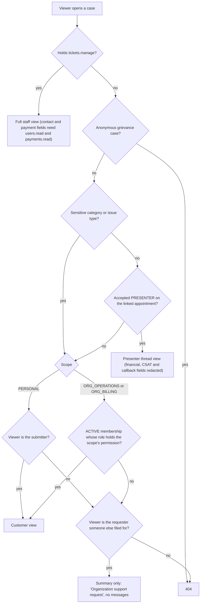

# Organization scopes and visibility

Every case has an **ownership scope** that decides who may read and write it. A PERSONAL case belongs to its submitter (`submitterUserId`), which is the customer even when staff file it for them. An ORG_OPERATIONS or ORG_BILLING case belongs to an organization, and whoever currently holds the matching organization permission may work on it, not the individual who happened to file it. A booking's organization tag never grants access to a personal case. This page is the "who can see what" grid for support, and it ends with how support sits beside the private feedback and public review rails.

## Scopes

| Scope            | Owned by        | Who corresponds (reads and writes the transcript)                                                         | Org permission                   |
| ---------------- | --------------- | --------------------------------------------------------------------------------------------------------- | -------------------------------- |
| `PERSONAL`       | The submitter   | The submitter, and platform operators.                                                                    | none                             |
| `ORG_OPERATIONS` | An organization | Any ACTIVE member whose role holds `supportCases.operations.manage`: OWNER, MAINTAINER, MANAGER, SUPPORT. | `supportCases.operations.manage` |
| `ORG_BILLING`    | An organization | Any ACTIVE member whose role holds `supportCases.billing.manage`: OWNER, MAINTAINER, BILLING_ADMIN.       | `supportCases.billing.manage`    |

The mapping is `caseOwnershipPermission()` in `lib/support/case-access.ts`, and the role grants are in `ORG_PERMISSIONS` (`lib/auth/org-permissions.ts`). The database requires an organization on every non-personal case (`support_case_ownership_and_appeal_shape` in `prisma/sql/check-constraints.sql`).

Separate from correspondence, an **accepted PRESENTER collaborator** on the appointment linked to a case (`Collaborator.status = ACCEPTED`, `tier = PRESENTER`) may read and reply to that case's thread. This is thread access only: it never grants CSAT, receipts, attachments, appeals, refund previews or refund actions, and it is not evidence access. CREW collaborators never gain it. A presenter sees the public transcript with `PAYMENT`, `REFUND` and `INVOICE` subjects, the payment card, CSAT, the callback window and internal notes all withheld. Presenter access is refused entirely for anonymous grievances (`externalRequesterEmail`) and for sensitive complaints: every category in `ORG_SENSITIVE_PERSONAL_CATEGORIES` and every issue type in `ORG_SENSITIVE_PERSONAL_ISSUE_TYPES` (`isSensitivePresenterCase()`). Those cases stay invisible to the presenter in lists, direct reads and notification fanout, so a safety concern or quality complaint about a presenter never reaches that presenter.

Platform operators (STAFF and ADMIN, via `tickets.manage`) correspond on every case. A case filed by an anonymous public grievance (`externalRequesterEmail` set) is staff-only: it has no in-app correspondents and appears in no customer or organization list.

## The rules and who enforces them

| Rule                                                                                                                        | Enforcer                                                                                                             | Test                                                                                            |
| --------------------------------------------------------------------------------------------------------------------------- | -------------------------------------------------------------------------------------------------------------------- | ----------------------------------------------------------------------------------------------- |
| Tagging a personal case with an organization grants no member access.                                                       | App: `canCorrespondOnCase()`.                                                                                        | `__tests__/support/case-access.test.ts`                                                         |
| An accepted PRESENTER on the linked appointment reads and replies to an ordinary thread; CREW never does.                   | App: `casePresenterIds()`, `isPresenterOnCase()`, `caseThreadPartyIds()`.                                            | `__tests__/support/case-access.test.ts`, `__tests__/support/evidence-parties.test.ts`           |
| Sensitive complaints and anonymous grievances never reach a presenter.                                                      | App: `isSensitivePresenterCase()`, `presenterSeesCaseThread()`, the presenter list predicate.                        | `__tests__/support/case-access.test.ts`, `__tests__/support/case-service-and-sla-sweep.test.ts` |
| Presenter thread access never grants CSAT, receipts, attachments, appeals or refunds.                                       | App: `canCorrespondOnCase()` stays owner/staff-only.                                                                 | `__tests__/support/route-authz-matrix.test.ts`                                                  |
| A presenter read withholds financial subjects, payment, CSAT and the callback window.                                       | App: `readSupportCaseForViewer()`, `readOwnSupportCase()`.                                                           | `__tests__/support/own-case-read.test.ts`                                                       |
| An organization case follows current membership: a departed filer loses access; any current permission holder continues it. | App: `canCorrespondOnCase()` re-reads the ACTIVE membership on every call.                                           | `__tests__/support/case-access.test.ts`, `__tests__/support/own-case-read.test.ts`              |
| Notifications go only to current thread parties.                                                                            | App: `caseCorrespondentIds()` for decisions and CSAT; `caseThreadPartyIds()` for intake, status and message notices. | `__tests__/support/case-access.test.ts`                                                         |
| The member a case was filed about sees a summary, never the transcript.                                                     | App: `projectCaseForViewer()` (`ORG_FILED_CASE_TITLE`, `filedByOrganizationNotice`).                                 | `__tests__/support/org-filed-subject-and-evidence-parties.test.ts`                              |
| Only an ACTIVE OWNER or MAINTAINER may file about another member, who must be an ACTIVE member of the same organization.    | App: `resolveOrgMembershipAccess()` in `app/api/support/cases/route.ts`.                                             | `__tests__/support/route-authz-matrix.test.ts`                                                  |
| An on-behalf filing never stays PERSONAL.                                                                                   | App: `withOnBehalfOwnership()` coerces it to ORG_OPERATIONS.                                                         | `__tests__/support/case-intake-scope.test.ts`                                                   |
| Organization views count sensitive personal complaints but never show who raised them.                                      | App: `ORG_SENSITIVE_PERSONAL_CATEGORIES` and the triage feed's `withheld.sensitivePersonal` count.                   | `__tests__/security/org-support-threads-sensitive.test.ts`                                      |
| Organization feeds return metadata only, never message bodies.                                                              | App: `THREAD_METADATA_SELECT` in `app/api/organizations/[orgId]/support-threads/route.ts`.                           | `__tests__/security/org-scope-payload-allowlist.test.ts`                                        |
| Evidence recipients see their own prompt and answer, never the case transcript.                                             | App: `GET /api/support/evidence/[requestId]`.                                                                        | `__tests__/support/evidence-route-authz.test.ts`                                                |
| Organization admins never read booking chats.                                                                               | App: chat routes need `supportChat.read`, a platform-operator surface.                                               | `__tests__/support/route-authz-matrix.test.ts`                                                  |

## Filing for an organization

`POST /api/support/cases` (`app/api/support/cases/route.ts`) applies these checks for a non-staff caller:

- **Organization scope.** Filing ORG_OPERATIONS or ORG_BILLING needs the scope's permission on an ACTIVE membership (403 otherwise) and an organization id (400 "Organization is required").
- **About another member.** Only an ACTIVE OWNER or MAINTAINER (`ALLOWED_ORG_SUBMITTER_ROLES`) may name another member as the requester, and that member must be ACTIVE in the same organization (403 `FORBIDDEN`). The case becomes ORG_OPERATIONS, so the member who is the subject sees only a summary, and access follows the organization's current team.
- **Payments.** A non-staff filer may attach only their own payment, or, for ORG_BILLING, a payment whose billing account belongs to the organization (404 "Payment not found" otherwise).
- **"About" an organization.** A member may tag a personal request as being about an organization only while ACTIVE and holding `supportRequests.org` (`canRaiseAboutOrg()` in `lib/support/about-org.ts`). The tag does not make the organization a correspondent.

Staff file a PERSONAL case for a customer with the customer as submitter, so it lands in the customer's own correspondence.

## What each surface shows

| Surface                                                                 | Gate                  | Shows                                                                                                                                                                                                        |
| ----------------------------------------------------------------------- | --------------------- | ------------------------------------------------------------------------------------------------------------------------------------------------------------------------------------------------------------ |
| Customer "Requests" (`GET /api/support/requests`)                       | Signed in             | Personal cases the viewer filed or requested, organization cases where they hold the permission, and cases on appointments they present (`visibleCaseAccess()`). Operators see only their own requests here. |
| Organization Support page (`/dashboard/organization/[orgId]/support`)   | `supportRequests.org` | ORG_OPERATIONS and ORG_BILLING cases the viewer may work on, with subject and metadata (`GET /api/organizations/[orgId]/support-tickets`).                                                                   |
| Organization Activity page (`.../support/activity`, `OrgSupportTriage`) | `operations.read`     | Appointment-linked cases of any scope as metadata only, with sensitive personal categories withheld as a count; a row links to the case only if the viewer may correspond.                                   |
| Organization evidence inbox                                             | Recipient only        | Evidence requests addressed to the viewer for bookings the organization sponsors or hosts (`evidenceAppointmentScope()` in `lib/support/evidence-scope.ts`).                                                 |
| Org-workspace Support pages                                             | Workspace member      | The viewer's personal and workspace requests only; organization-owned cases stay in the organization dashboard.                                                                                              |
| Back-office inbox and workspace                                         | `tickets.manage`      | Every case; contact details need `users.read`, payment subjects need `payments.read`, recommendations and holds need `payments.read`.                                                                        |

`ORG_SENSITIVE_PERSONAL_CATEGORIES` lists the personal categories an organization may count but not see: ORG_ADMIN_DISPUTE, QUALITY_COMPLAINT, GRIEVANCE, CONSULTANT_NO_SHOW, CONSULTANT_LATE, SESSION_ENDED_EARLY, SESSION_QUALITY_POOR and WRONG_CONSULTANT, SAFETY_CONCERN and CONDUCT_REMOVAL. Non-sensitive personal cases on the organization's bookings do appear in the activity feed as metadata, including the requester's name.

## Evidence parties

Staff can ask the other side for evidence. The eligible recipients for a booking (`evidenceRecipientsByAppointment()` in `lib/support/case-actions.ts`) are: confirmed or attended consultant participants, the plan's consultant, ACCEPTED PRESENTER collaborators (crew never), and ACTIVE OWNER, MAINTAINER, MANAGER and SUPPORT members of the host organization of a captured payment on the booking. Banned users are excluded. A recipient who stops being eligible loses the request (404 on read, 403 "Your delivery or organization access has changed" on answer). An evidence request shows only the recipient's prompt and answer; it never opens the case thread. Presenter thread access is a separate party role and comes from the linked appointment, not from being asked for evidence. Details are in [evidence and attachments](04-evidence-and-attachments.md).

## Worked example

IIT Madras (the seeded hybrid organization) sponsors and hosts a class taught by Hannah Anderson. Priya Anderson attends.

- Priya files "The session ended 20 minutes early" about the class. It is PERSONAL with category SESSION_ENDED_EARLY. IIT Madras's MANAGER sees one more item in the activity feed's withheld count, never Priya's name or words. Staff ask Hannah and IIT Madras's SUPPORT member for evidence; each sees only their own prompt.
- IIT Madras's OWNER files a billing question about an invoice. It is ORG_BILLING. IIT Madras's BILLING_ADMIN and MAINTAINER can read and reply; the MANAGER cannot.
- Priya is also a LEARNER member of IIT Madras. The OWNER files about her repeated no-shows, naming her as requester. The route makes it ORG_OPERATIONS. Priya sees a summary titled "Organization support request" with no messages; the OWNER, MAINTAINER, MANAGER and SUPPORT members correspond.
- The OWNER leaves IIT Madras. Their membership is no longer ACTIVE, so they lose both organization cases at once. The MAINTAINER continues them with the full transcript.

## Support beside feedback and reviews

Three sibling rails hang off a booking, and each answers a different question. A **rating** is about a conversation, a **review** is about a person, and a **case** is about a problem.

| Rail                      | Model                                          | Visibility                                                                                                             | Reference                                   |
| ------------------------- | ---------------------------------------------- | ---------------------------------------------------------------------------------------------------------------------- | ------------------------------------------- |
| Private per-call feedback | `AppointmentFeedback`                          | The rater sees score and note; the rated party sees the score; an organization sees an aggregate above a cohort floor. | [feedback](../feedback/README.md)           |
| Public review             | `ConsultantReview`, `ConsultantReviewRevision` | Public on the expert's profile; staff moderate through `ModerationAction`.                                             | [reviews](../reviews/README.md)             |
| Support case              | `SupportCase` and related rows                 | As in the scopes above.                                                                                                | This folder                                 |
| Support CSAT              | `SupportCase.csatRating`                       | Staff reporting only.                                                                                                  | [case lifecycle](02-case-lifecycle.md#csat) |
| Self-service helpfulness  | `SupportFlowOutcome.helpfulRating`             | Staff analytics only.                                                                                                  | [intake and flows](01-intake-and-flows.md)  |

A moderation action on a review or a rating can be appealed through a support case (`MODERATION_APPEAL`), reviewed by a different operator; see [decisions and appeals](03-decisions-appeals-and-supersede.md#appeals).

Presenter read grants are rechecked after case selection. A revoked presenter
receives no case detail; a requester who loses organization correspondence keeps
only the summary. Payment and CSAT fields require a current correspondent grant.

## Where in code

- `lib/support/case-access.ts`: `canCorrespondOnCase()`, `caseCorrespondentIds()`, `casePresenterIds()`, `isPresenterOnCase()`, `caseThreadPartyIds()`, `visibleCaseAccess()`, `projectCaseForViewer()`, `caseOwnershipPermission()`, `ORG_SENSITIVE_PERSONAL_CATEGORIES`, `ORG_SENSITIVE_PERSONAL_ISSUE_TYPES`, `isSensitivePresenterCase()`.
- `lib/support/evidence-parties.ts`: `deliveringPartiesByAppointment()`, `presenterCollaboratorWhere()`, `presenterAppointmentWhere()`, `presenterAppointmentIdsIn()`.
- `lib/support/case-message-actor.ts`: the persisted presenter marker and `isPresenterAuthoredMessage()`.
- `lib/support/about-org.ts`, `lib/support/evidence-scope.ts`, `lib/auth/org-permissions.ts`, `lib/auth/backoffice-permissions.ts`.
- `app/api/support/cases/route.ts`, `app/api/support/requests/route.ts`, `app/api/organizations/[orgId]/support-threads/route.ts`, `app/api/organizations/[orgId]/support-tickets/route.ts`.
- `app/dashboard/organization/[orgId]/support/OrgSupportRequests.tsx`, `app/dashboard/organization/[orgId]/support/OrgSupportTriage.tsx`.

## Deprecated & Superseded Approaches

- **The ticket and thread split.** Support used to be stored as separate tickets and per-appointment threads, with reporters aggregated across them, so ownership was implied by where a message lived. One case with an explicit ownership scope replaced both. Thread-era names survive only in identifiers such as the `/support-threads` route, `SupportThreadCategory` and the `threads.manage` surface, which no route uses.
- **Access inferred from an organization tag.** Older guidance warned against reading correspondence access from a booking's organization tag. The scope column now decides access, and a personal case stays private to its submitter and operators however it is tagged.
- **Access tied to the filer.** Organization cases are never owned by the member who filed them; access is re-read from current ACTIVE memberships on every request, so departures and successors need no handover step.
- **Operator controls shown to customers.** The early resolution panel showed customers operator controls such as "Record organization handover". Staff and customer views are now separate components, and the handover action no longer exists.
