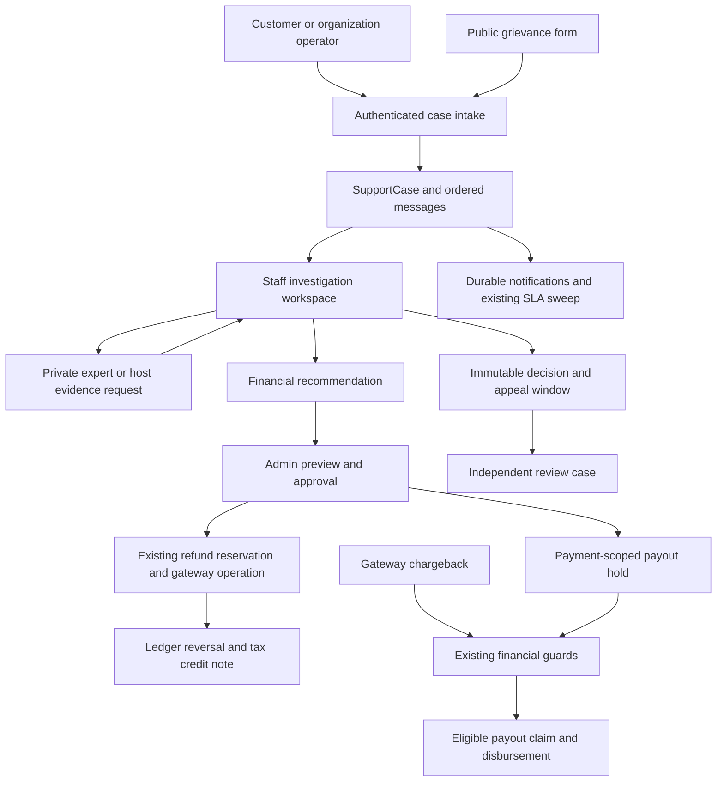

# Support and trust production architecture

`SupportCase` is the only persistence model for appointment help, account help,
organization correspondence and grievances. Messages, evidence, decisions,
financial recommendations and appeals attach to that case. The database contains
mock data during pre-MVP development; obsolete support tables and compatibility
paths have been removed rather than migrated.

## Runtime design

A service complaint does not create a bank chargeback. Gateway `Dispute` rows
retain the provider's references, lifecycle, evidence deadline, and money guards.
The case links the service investigation to its payment and refund.

Platform mediation is explicit: a participant selects Get help, staff request
neutral evidence from the other relevant party, then record a decision. Ordinary
chat remains participant messaging, with abuse reports routed to moderation.
Staff do not automatically join private chats or monitor disagreements. Evidence
recipients see the prompt, their response and the permitted decision outcome;
they do not receive the complainant’s private correspondence or full explanation.

Booking context cards in Messages provide a Get help shortcut to the existing
appointment support flow in the current dashboard. The server still checks
appointment access; following the link neither submits a complaint nor shares the
chat transcript. Pair conversations may cover several bookings, so the shortcut
belongs to the specific booking card rather than guessing an appointment from
the channel. Direct negotiation is optional, including for safety complaints.

Follow-ups continue in the case; challenges to a recorded decision use its one
independent appeal per eligible person within the stored deadline. A new report
does not undo that decision or create another refund entitlement. Product
feedback and public reviews do not act as appeal conversations.

| Term            | Meaning and owner                                                                                                 |
| --------------- | ----------------------------------------------------------------------------------------------------------------- |
| Service dispute | A support case about the appointment or service; staff investigate and mediate.                                   |
| Chargeback      | A bank/provider payment dispute; admin handles evidence and provider deadlines in the finance workflow.           |
| Refund          | An approved return of a payment, reserved and executed through existing finance controls.                         |
| Clawback        | Recovery of already-paid earnings through the existing ledger and future payout offsets; no automatic bank debit. |
| Payment hold    | A separate admin block on eligible unpaid earnings during investigation; it cannot recall a completed payout.     |

A complaint or low rating does not trigger a refund, hold or clawback. The
provider’s chargeback process is separate from the platform’s service decision;
see [Razorpay’s dispute documentation](https://razorpay.com/docs/payments/disputes/).

### Ownership and authorization

- Staff investigate and communicate. Admin alone executes money operations,
  service holds, and restricted enforcement reversals.
- `PERSONAL` cases belong to their submitter. A member who is the subject of an
  organization-filed personal case receives a summary, never its correspondence.
- `ORG_OPERATIONS` correspondence is available to active OWNER, MAINTAINER,
  MANAGER and SUPPORT members. `ORG_BILLING` correspondence is available to
  OWNER, MAINTAINER and BILLING_ADMIN. Organization tagging alone grants no
  correspondence access.
- Organization handovers preserve authorship and record an event. Notifications
  target current eligible members; organization emails link to the authorized
  workspace without copying its transcript. Access rechecks current membership.
- A signed-in public grievance belongs to the account and appears in its
  dashboard and privacy export. An anonymous grievance stores explicit external
  contact fields on a case held by the non-staff `system-public-grievance-intake`
  user, so no operator's deletion cascades into it. Those cases are staff-only.
  Until the complainant confirms their address through a signed seven-day link,
  replies, status changes and decisions are emailed as the reference only.
- `/dashboard/support/c_<id>` resolves a notification to the viewer's authorized
  workspace. Case access is checked before choosing the destination.

### Dashboard navigation

Every active personal, workspace and organization dashboard exposes an Operations
group with Help & support and the Settings destination permitted in that scope.
Personal help uses separate routed pages for Support requests, Evidence requests,
Reports & appeals, and Product feedback. One stable Help & support heading sits above horizontal underline page links;
selected sections use smaller headings rather than another large page title.
Context and status filters narrow the paginated personal case inbox. Product
feedback is a separate form/history module, not a support conversation. Session
ratings stay on appointments and experts' received public reviews stay in Business.

Request and evidence details retain the dashboard shell. Their secondary menu is
removed on detail routes to give the conversation or response form a full main
column alongside its context panel. The panel stacks above the form on mobile.
The profile-free evidence notification URL authorizes the recipient and redirects
to their dashboard; it renders no standalone evidence page.

Organization support lists only organization-owned conversations allowed by the
current member's operations/billing grants. The operations triage counts, but
never lists, a member's personal complaint about the organization or its people. Its evidence inbox stays recipient-only
and matches that organization's sponsored or hosted appointments. Personal reports
and product feedback are explicitly linked into the viewer's personal workspace,
never rendered as organization-owned records. Member support activity is a separate
operations-only page. Settings remains available from the avatar as a shortcut;
the mobile menu includes each Settings destination once.

The main dashboard navigation stays vertical and scrolls independently, with
keyboard focus and fixed header/find controls. Page-level status and context are
filters; only a view of the same records uses tabs. Settings uses a grouped hub
leading to individual form pages with a back link, rather than an inner sidebar
and another row of nested tabs.

New request is the primary inbox action, with appointment help secondary.
Guided help and suggested articles live together in a collapsed Find an answer
section below the requests.

Recent-appointment pickers use booking title, date, time, kind and organization
when available. No generated thread summary is used. Reports use the same shared
segmented control as other dashboard views, with native keyboard behavior.

### Decisions, evidence and appeals

`SupportCaseEvidenceRequest` gives one delivery participant or current host
representative a neutral prompt and deadline. The default is 48 calendar hours,
capped by the case deadline. The recipient sees their own response and evidence,
not the customer's transcript. A late response is visibly late and does not
establish liability by itself. A finalized response is not editable.

`SupportCaseDecision` records an immutable explanation, outcome, operator and
appeal deadline. Case decisions permit seven-day appeals; review moderation uses
six calendar months. Appeals are cases linked to the original decision/action,
unique per appellant. Assignment and adjudication reject the original operator.
A missing independent reviewer leaves the appeal pending. Financial appeals
still use admin-executed recommendations. Reversible review moderation uses
explicit compensating actions; existing account reinstatement retains its
external enforcement recovery.

`SupportFinancialRecommendation` stores paise, payment, author and reason.
Admin approval requires a fresh refundable-balance preview. The existing refund
front door reserves and links the refund using the recommendation as its stable
operation identity. A retry resumes that operation. Gateway acceptance and bank
receipt are distinct states in the UI.

Refund review uses the shared admin money door: a fresh session, a reason of at
least five characters, the per-admin money-action budget and an `OpsActionLog`
row. A refund above ₹25,000 waits in Money → Approvals when at least two admins
are active; a different admin approves the stored request before execution. A
single active admin can execute it directly. The recommendation remains
undecided while approval is pending. Execution retains the case access,
independent appeal review, case version and previewed refundable-balance checks.
Declining a recommendation or retrieving its existing keyed refund moves no new money and
requires no second approval. The case panel labels a pending approval separately
from a sent refund.

`SupportPaymentHold` independently blocks linked unpaid earnings during batching
and disbursement. Releasing a service hold does not release a chargeback or refund
reservation. An in-flight payout requires investigation; completed payouts cannot
be recalled by creating a hold.

### Storage, concurrency and deadlines

Evidence uses private `support-attachments` storage with bucket limits set in
code, direct signed uploads, and server verification of the stored type, size and
leading bytes before completion; a mismatched object is removed. Downloads
recheck access and issue short-lived signed URLs. Submitted evidence is retained
with the case; pending uploads can be withdrawn.

Case metadata uses optimistic concurrency. Messages have ordered sequences and
client retry identities. Financial operations retain existing Serializable
reservations, conditional claims and immutable balanced ledger postings. External
calls occur outside database transactions. Holds participate in payout claim
transactions. Sidecar constraints enforce the new ownership, appeal and hold
shapes; application code does not sweep database-enforced ledger invariants.

Guided self-service starts no operator SLA clock. Formal intake or the first
human handoff captures `receivedAt` and the category deadline. That deadline is
fixed at receipt and does not pause while waiting for a customer. Internal SLA targets may pause, bounded by the absolute deadline.
The existing SLA sweep sends bounded support, evidence and moderation notices;
there is no additional scheduler. The public policy and applicability of statutory
categories remain accountable legal/business inputs, not an automatic compliance
certification. The implemented tax model and INR settlement are unchanged.

## Schema and deployment

The Prisma schema and SQL sidecars describe the complete current system. Seed
phase `9b-create-support-cases.ts` creates canonical cases with ordered messages,
reference allocation, receipt deadlines and audit events. There is no import,
backfill, alias registry or dual-write phase.

For the authorized pre-MVP cleanup, Supabase migrations removed obsolete mock
support tables and added the case evidence, decision, recommendation and hold
schema. Schema changes were restricted to support and related moderation fields;
unrelated money tables and their sidecar invariants were preserved. Generate the
Prisma client after schema edits. CI recreates the schema and sidecars in a
throwaway database; local servers, builds, lint and test runs are not required for
this change. Once customer data exists, destructive changes need a reviewed
migration and deployment sequence.

## Release evidence

CI owns typechecking, lint, formatting, full affected tests, build, sidecar guards,
and isolated database checks. Local review uses CodeRabbit findings verified
against the current diff and Sonar where available. An unavailable review service
or skipped analysis is not a clean result. Preview and Razorpay test-mode evidence
remain required before declaring operational readiness.

CA determinations, named officers, staffing coverage, NCH enrollment and actual
filing acknowledgments are external release evidence. Generated tax exports are
not filed returns. Do not label future-effective obligations already operative.

## Deprecated & Superseded Approaches

Separate ticket/thread tables, legacy aliases, migration scripts, retired API
stubs and dual-parent events were removed while all data was disposable. New
features must attach directly to the canonical case. A universal pausing
resolution deadline is superseded by category-specific absolute deadlines;
internal wait accounting cannot extend them. Service complaints remain separate
from issuing-bank chargebacks.

The support page no longer nests Feedback, Evidence and Reports inside Requests,
or adds Sessions/Platform subtabs beneath them. Those tasks have separate routed
pages; the inbox uses context filters. The former evidence-only layout and
avatar-only Settings placement are superseded by dashboard detail routes and
Operations navigation. Support conversation summaries are not generated.
