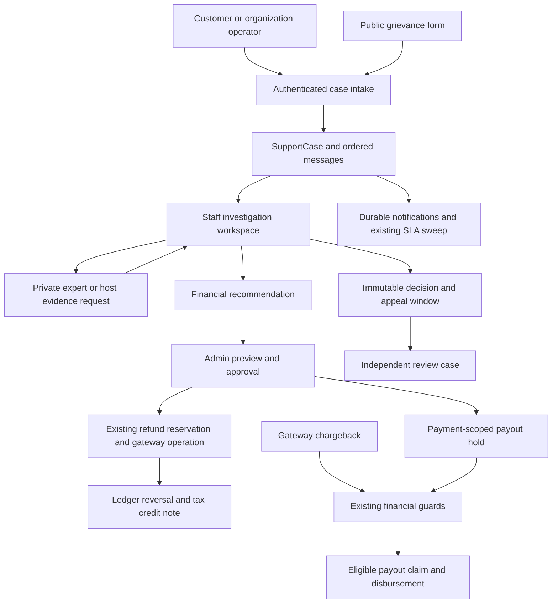

# Support and trust production cutover

The application reads and writes `SupportCase` for appointment help, account help,
organization correspondence, and grievances. `SupportTicket` and
`AppointmentSupportThread` are migration sources. Their historical URLs resolve
through `SupportCaseLegacyAlias`; retired mutation APIs return `410`.

## Runtime design

A service complaint does not create a bank chargeback. Gateway `Dispute` rows
retain the provider's references, lifecycle, evidence deadline, and money guards.
The case links the service investigation to its payment and refund.

### Ownership and authorization

- Staff investigate and communicate. Admin alone executes money operations,
  service holds, and restricted enforcement reversals.
- `PERSONAL` cases belong to their submitter. A member who is the subject of an
  organization-filed personal case receives a summary, never its correspondence.
- `ORG_OPERATIONS` correspondence is available to active OWNER, MAINTAINER,
  MANAGER and SUPPORT members. `ORG_BILLING` correspondence is available to
  OWNER, MAINTAINER and BILLING_ADMIN. Organization tagging alone grants no
  correspondence access.
- Organization handovers preserve authorship and record an event. Notifications
  target current eligible members; organization emails link to the authorized
  workspace without copying its transcript. Access rechecks current membership.
- Anonymous public grievances store explicit external contact fields. Operator
  foreign keys identify queue custody, not the complainant. Those cases are
  staff-only; external replies use the guarded email outbox.
- `/dashboard/support/c_<id>` resolves a notification to the viewer's authorized
  workspace. Historical ticket/thread links resolve aliases before authorization.

### Decisions, evidence and appeals

`SupportCaseEvidenceRequest` gives one delivery participant or current host
representative a neutral prompt and deadline. The default is 48 calendar hours,
capped by the case deadline. The recipient sees their own response and evidence,
not the customer's transcript. A late response is visibly late and does not
establish liability by itself. A finalized response is not editable.

`SupportCaseDecision` records an immutable explanation, outcome, operator and
appeal deadline. Case decisions permit seven-day appeals; review moderation uses
six calendar months. Appeals are cases linked to the original decision/action,
unique per appellant. Assignment and adjudication reject the original operator.
A missing independent reviewer leaves the appeal pending. Financial appeals
still use admin-executed recommendations. Reversible review moderation uses
explicit compensating actions; existing account reinstatement retains its
external enforcement recovery.

`SupportFinancialRecommendation` stores paise, payment, author and reason.
Admin approval requires a fresh refundable-balance preview. The existing refund
front door reserves and links the refund using the recommendation as its stable
operation identity. A retry resumes that operation. Gateway acceptance and bank
receipt are distinct states in the UI.

`SupportPaymentHold` independently blocks linked unpaid earnings during batching
and disbursement. Releasing a service hold does not release a chargeback or refund
reservation. An in-flight payout requires investigation; completed payouts cannot
be recalled by creating a hold.

### Storage, concurrency and deadlines

Evidence uses private `support-attachments` storage, direct signed uploads, and
server verification of the stored type and size before completion. Downloads
recheck access and issue short-lived signed URLs. Submitted evidence is retained
with the case; pending uploads can be withdrawn. Storage objects are not copied
when legacy attachment metadata is migrated.

Case metadata uses optimistic concurrency. Messages have ordered sequences and
client retry identities. Financial operations retain existing Serializable
reservations, conditional claims and immutable balanced ledger postings. External
calls occur outside database transactions. Holds participate in payout claim
transactions. Sidecar constraints enforce the new ownership, appeal and hold
shapes; application code does not sweep database-enforced ledger invariants.

Guided self-service starts no operator SLA clock. Formal intake or the first
human handoff captures `receivedAt` and the category deadline, fixed at receipt and do not pause while waiting for a
customer. Internal SLA targets may pause, bounded by the absolute deadline.
The existing SLA sweep sends bounded support, evidence and moderation notices;
there is no additional scheduler. The public policy and applicability of statutory
categories remain accountable legal/business inputs, not an automatic compliance
certification. The implemented tax model and INR settlement are unchanged.

## Ordered deployment

1. Record the release SHA and take a recoverable database backup. Review the
   additive Prisma schema and sidecar SQL against read-only drift output.
2. Rehearse on a throwaway database. Expand the schema without replacing the
   open-case partial index until existing subject keys have been initialized.
3. Set `SUPPORT_MIGRATION_DATABASE_URL` explicitly. The script never falls back
   to `DATABASE_URL` or reads a local `.env` implicitly.
4. Run `npx tsx scripts/db/migrate-support-cases.ts --dry-run --prepare-only`.
   Its JSON report contains identifiers and counts, not transcripts or credentials.
5. Enter the bounded support-write maintenance window; stop case-producing jobs
   and drain instances running old support writers.
6. Run the same script with `--apply --prepare-only --ack-host=<exact host:port>`.
   Repeat preparation batches until that phase reports `complete: true`. This
   initializes subject keys, deadline snapshots and closed timestamps before
   replacing the old open-case index.
7. Apply and assert the reviewed sidecars, including the ownership-aware open-case
   index. Resolve existing open-scope or reporter/content uniqueness collisions
   explicitly; never silently merge private correspondence.
8. Run `npx tsx scripts/db/migrate-support-cases.ts --dry-run`, then run with
   `--apply --ack-host=<exact host:port>` against the reviewed target. Each apply
   invocation imports up to 1,000 source cases in batches of 50 by default; reruns
   select remaining unaliased sources. Use `--max-sources=N` for a larger audited
   dry run. Resolve every collision or failed source before continuing.
9. Require migration-phase `complete: true`: zero failed sources and zero missing
   ticket/thread aliases. Verify per-source message, event, attachment and alias
   counts. Confirm next-reference allocation exceeds retained references.
10. Switch active application readers/writers together, verify receipts and
    attachment aliases, then resume the scheduler and support traffic.

Each source group is transactional: a linked ticket and thread become one case.
Message ordering preserves original thread sequence for equal timestamps and
records provenance. Private notes retain visibility. Existing references and
original timestamps survive. Legacy closed rows without `closedAt` must be
normalized before the open-case unique index is validated.

After new unified writes begin, roll forward. Returning to old writers without a
reviewed reverse migration would strand new correspondence. Keep source tables
inert until recovery verification and an explicitly reviewed contract release.
Do not run the migration, push schema, seed, or replay money against the shared
project from a worktree.

## Release evidence

CI owns typechecking, lint, formatting, full affected tests, build, sidecar guards,
and isolated database checks. Local review uses CodeRabbit findings verified
against the current diff and Sonar where available. An unavailable review service
or skipped analysis is not a clean result. Preview and Razorpay test-mode evidence
remain required before declaring operational readiness.

CA determinations, named officers, staffing coverage, NCH enrollment and actual
filing acknowledgments are external release evidence. Generated tax exports are
not filed returns. Do not label future-effective obligations already operative.

## Deprecated & Superseded Approaches

Legacy ticket/thread runtime reads, cross-reporter report aggregation and
operator attachment access without mandatory 2FA are retired. Historical source
tables remain solely for the reviewed migration/recovery window. There is no
legacy dual-write path or second support queue.

A universal 15-day resolution clock with customer-wait extensions is superseded
by category-specific absolute deadlines. Internal service complaints remain
separate from issuing-bank chargebacks. A single report row no longer represents
multiple reporters' private statements or consumes their separate appeal rights.
