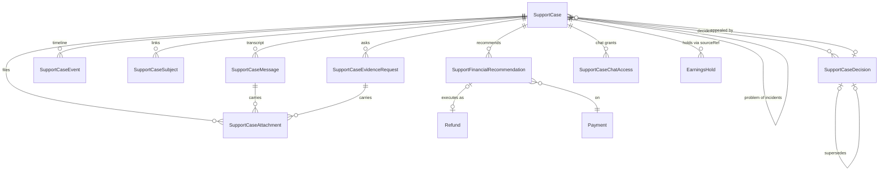

# Schema and invariants reference

This page lists every support table, what each column group is for, and every invariant with the thing that enforces it. "Database" means a constraint, index or trigger in `prisma/sql/check-constraints.sql` (the sidecar), which survives any application bug. "App" means TypeScript that a new code path could bypass, so a new writer must call the same helper.

The sidecar is applied separately from `prisma/schema.prisma`. Never run `prisma db push` against the shared database: it would drop the sidecar's partial unique indexes (AGENTS.md §2.3). The schema comment on `SupportCase` forbids declaring an index on the open-scope tuple for the same reason.

## Entity map

`EarningsHold` is not a foreign key: a support hold is an `EarningsHold` row with `reason = SUPPORT_CASE` and `sourceRef = caseId`.

## Tables

### `SupportCase`

| Columns                                                                                                                                                                    | Purpose                                                                                                                                                                                                                                                                                                                                                                |
| -------------------------------------------------------------------------------------------------------------------------------------------------------------------------- | ---------------------------------------------------------------------------------------------------------------------------------------------------------------------------------------------------------------------------------------------------------------------------------------------------------------------------------------------------------------------- |
| `referenceNumber`                                                                                                                                                          | `FAM-<IST year>-<6 digits>`, unique, from `SupportCaseCounter`.                                                                                                                                                                                                                                                                                                        |
| `clientIntakeId`                                                                                                                                                           | Retry key of the intake; unique per submitter.                                                                                                                                                                                                                                                                                                                         |
| `title`, `description`, `category`, `flowKey`, `currentNodeId`                                                                                                             | What the case is about and where its guided flow stands.                                                                                                                                                                                                                                                                                                               |
| `flowReason`                                                                                                                                                               | The reason of the no-show flow terminal the person reached, validated by `SupportFlowReasonEnum`. Written by `recordFlowReasonTx()` only for a `NO_SHOW` turn: it fills an empty value or replaces one that counts for no verdict, and never replaces a counted one. The window-close pass reads it (see [a no-show report](01-intake-and-flows.md#a-no-show-report)). |
| `flowReasonAt`                                                                                                                                                             | When the person answered `flowReason`; written in the same compare-and-set, so a kept counted reason keeps its time. The report window is judged on it, not on `createdAt`.                                                                                                                                                                                            |
| `activeChannel`                                                                                                                                                            | SELF_SERVE or HUMAN in practice (AI exists in the enum and is unused). Only ever moves to HUMAN.                                                                                                                                                                                                                                                                       |
| `issueType`, `priority`, `status`, `caseKind`, `problemCaseId`                                                                                                             | Triage, the [lifecycle](02-case-lifecycle.md) status, and problem/incident linking.                                                                                                                                                                                                                                                                                    |
| `requesterUserId`, `submitterUserId`, `organizationId`, `ownershipScope`, `scopeKey`                                                                                       | Who it is about, who filed it, and which [scope](09-org-scopes-and-visibility.md) owns it.                                                                                                                                                                                                                                                                             |
| `appointmentId`, `appointmentOccurrenceId`, `assignedToId`                                                                                                                 | Booking link and assignee. `appointmentOccurrenceId` has a plain index in `prisma/schema.prisma` (not a sidecar object) for the by-session read of no-show reports.                                                                                                                                                                                                    |
| `callbackPhone`, `callbackWindow`                                                                                                                                          | Structured callback request.                                                                                                                                                                                                                                                                                                                                           |
| `receivedAt`, `ackDueAt`, `acknowledgedAt`, `resolutionDueAt`, `statutoryDueAt`, `reopenedAt`, `deadlinePolicy`, `firstAgentReplyAt`, `awaitingUserSince`, `pausedSeconds` | [Clocks](01-intake-and-flows.md#references-and-clocks).                                                                                                                                                                                                                                                                                                                |
| `resolvedAt`, `closedAt`, `deletedAt`                                                                                                                                      | Lifecycle timestamps; `closedAt` starts the purge clock.                                                                                                                                                                                                                                                                                                               |
| `messageSeq`, `lastMessageAt`                                                                                                                                              | Message sequence allocator and the newest-message guard.                                                                                                                                                                                                                                                                                                               |
| `csatRating`, `csatAt`                                                                                                                                                     | Resolution CSAT.                                                                                                                                                                                                                                                                                                                                                       |
| `legalHoldAt`                                                                                                                                                              | Admin legal hold; blocks the 180-day purge.                                                                                                                                                                                                                                                                                                                            |
| `externalRequesterEmail`, `externalRequesterName`                                                                                                                          | Anonymous grievance contact.                                                                                                                                                                                                                                                                                                                                           |
| `appealOfDecisionId`, `appealOfModerationActionId`                                                                                                                         | Set on appeal cases.                                                                                                                                                                                                                                                                                                                                                   |
| `moderationReportId`                                                                                                                                                       | The report a case was opened from; unique.                                                                                                                                                                                                                                                                                                                             |

### Related tables

| Table                            | Purpose                                                                                                                                                                       | Key uniques                                        |
| -------------------------------- | ----------------------------------------------------------------------------------------------------------------------------------------------------------------------------- | -------------------------------------------------- |
| `SupportCaseCounter`             | One row per IST year; `nextSeq` for references.                                                                                                                               | `year` primary key                                 |
| `SupportCaseSubject`             | Typed links (APPOINTMENT, OCCURRENCE, PAYMENT, REFUND, INVOICE, ORGANIZATION, ACCOUNT).                                                                                       | `(caseId, subjectType, subjectId)`                 |
| `SupportCaseMessage`             | The transcript: `seq`, sender (USER, BOT, AGENT, SYSTEM), body, `isInternal`, `clientTurnId`, metadata.                                                                       | `(caseId, seq)`, `(caseId, clientTurnId)`          |
| `SupportCaseEvent`               | Typed audit timeline (`SupportCaseEventKind`), with from/to values and a note.                                                                                                | none                                               |
| `SupportCaseEvidenceRequest`     | A private question to one party, its deadline and answer.                                                                                                                     | `(caseId, clientActionId)`                         |
| `SupportCaseDecision`            | Outcome, explanation, private rationale, `appealUntil`, `supersedesDecisionId`.                                                                                               | `(caseId, clientActionId)`, `supersedesDecisionId` |
| `SupportFinancialRecommendation` | Payment, amount in paise, reason, `releaseSeat` (marks the funded seat REFUNDED when the refund is sent; never cancels the booking), review verdict, void stamps, `refundId`. | `(caseId, clientActionId)`, `refundId`             |
| `SupportCaseAttachment`          | Private file metadata; `storagePath`, `completedAt`, `deletedAt`.                                                                                                             | `storagePath`                                      |
| `SupportCaseChatAccess`          | Append-only log of staff chat grants.                                                                                                                                         | `opsActionId`                                      |
| `SupportFlowOutcome`             | One row per terminal guided turn; counts, no message bodies.                                                                                                                  | none                                               |
| `EarningsHold`                   | Shared payout hold; support rows use `reason = SUPPORT_CASE`, `sourceRef = caseId`.                                                                                           | see sidecar                                        |

Most foreign keys from evidence, decisions, recommendations, attachments and chat grants to their case are `onDelete: Restrict`, so a case with formal history cannot be hard-deleted; erasure scrubs instead ([privacy](08-privacy-and-retention.md#erasure)).

## Sidecar objects

| Object                                                                                   | Kind                   | Rule                                                                                                                                      |
| ---------------------------------------------------------------------------------------- | ---------------------- | ----------------------------------------------------------------------------------------------------------------------------------------- |
| `support_case_open_scope_key`                                                            | Partial unique index   | One open, undeleted case per (scope, organization, scope key, requester, submitter, category), NULLS NOT DISTINCT.                        |
| `support_case_subject_primary_key`                                                       | Partial unique index   | At most one primary subject per case.                                                                                                     |
| `support_case_scope_and_shape_chk`                                                       | CHECK                  | A category or flow key; an occurrence implies an appointment; only incidents link to a problem; CSAT 1–5.                                 |
| `support_case_ownership_and_appeal_shape`                                                | CHECK                  | Non-personal cases name an organization; at most one appeal target.                                                                       |
| `support_case_attachment_shape`                                                          | CHECK                  | At most one of message or evidence request; size not negative.                                                                            |
| `support_recommendation_shape`                                                           | CHECK                  | Decided fields all set or all null; a void needs a decided, now unapproved row; amount not negative.                                      |
| `support_recommendation_one_open_per_payment`                                            | Partial unique index   | One undecided recommendation per payment.                                                                                                 |
| `support_case_decision_immutable`                                                        | Trigger                | Decisions are never updated or deleted.                                                                                                   |
| `support_decision_one_original_per_case`                                                 | Partial unique index   | One decision per case that supersedes nothing.                                                                                            |
| `support_case_closed_at_idx`                                                             | Partial index          | Keeps the purge scan cheap.                                                                                                               |
| `earnings_hold_one_earning`                                                              | CHECK                  | A hold freezes exactly one consultant or organization earning.                                                                            |
| `earnings_hold_active_consultant_key`, `earnings_hold_active_org_key`                    | Partial unique indexes | One active hold per (earning, reason, source).                                                                                            |
| `ops_action_proposal_one_open_key`                                                       | Partial unique index   | One open second-admin proposal per (action, target).                                                                                      |
| `support_chat_access_shape`                                                              | CHECK                  | Ended grants name a reason; only interventions carry Stream stamps; `OPEN_CASE` is READ-only; notice after end; at least one scoped user. |
| `support_chat_one_live_intervention_per_channel`                                         | Partial unique index   | One live Familiarise Support seat per channel.                                                                                            |
| `support_chat_one_live_read_per_operator`                                                | Partial unique index   | One live READ grant per operator per case.                                                                                                |
| `support_chat_access_append_only`                                                        | Trigger                | Grants are never deleted; only end, Stream and notice stamps may be set, once.                                                            |
| `support_chat_access_live_expiry_idx`, `..._pending_leave_idx`, `..._pending_notice_idx` | Partial indexes        | Keep the sweep's chat scans cheap.                                                                                                        |

## Invariants by enforcer

| #   | Invariant                                                                                                                                                                  | Enforcer                                                                                                                  | Detail                                                                |
| --- | -------------------------------------------------------------------------------------------------------------------------------------------------------------------------- | ------------------------------------------------------------------------------------------------------------------------- | --------------------------------------------------------------------- |
| 1   | One open case per scope tuple.                                                                                                                                             | Database (`support_case_open_scope_key`); app dedupe first.                                                               | [intake](01-intake-and-flows.md#create-or-reuse)                      |
| 2   | Messages have unique per-case sequence numbers; a retried turn is stored once.                                                                                             | Database (`(caseId, seq)`, `(caseId, clientTurnId)`).                                                                     | [lifecycle](02-case-lifecycle.md#messages-and-concurrency)            |
| 3   | Only listed status moves by listed actors; decided cases never reopen.                                                                                                     | App (`CASE_TRANSITIONS`, `reopenRefusalTx()`).                                                                            | [lifecycle](02-case-lifecycle.md)                                     |
| 4   | Writes never overwrite a newer version; staff replies never cross an unseen customer message.                                                                              | App (compare-and-set on `updatedAt`, `lastMessageAt`).                                                                    | [lifecycle](02-case-lifecycle.md#messages-and-concurrency)            |
| 5   | The channel never leaves HUMAN.                                                                                                                                            | App (no writer sets another value).                                                                                       | [lifecycle](02-case-lifecycle.md)                                     |
| 6   | Decisions are immutable; one original per case; corrections supersede the decision in force within its window.                                                             | Database (trigger, partial unique); app (`supersedeDecisionTx()`).                                                        | [decisions](03-decisions-appeals-and-supersede.md)                    |
| 7   | Appeals are reviewed by someone else.                                                                                                                                      | App (`assertIndependentReviewer()`, `hasConflictingAppealReviewerTx()`).                                                  | [decisions](03-decisions-appeals-and-supersede.md#appeals)            |
| 8   | `REFUND_APPROVED` needs a live refund; no decision with an open recommendation.                                                                                            | App (`assertDecisionMatchesMoney()`, `assertNoOpenRecommendation()`).                                                     | [decisions](03-decisions-appeals-and-supersede.md)                    |
| 9   | One undecided recommendation per payment; one reviewer claims it.                                                                                                          | Database (partial unique); app (compare-and-set on `decidedAt`).                                                          | [money](05-money-remedies.md)                                         |
| 10  | Staff refund caps: ₹5,000 per payment cumulative, ₹50,000 per rolling 24 h.                                                                                                | App (`assertBoundedRefund()`, Redis lock `staff-refund:<userId>`).                                                        | [money](05-money-remedies.md#staff-caps-across-every-refund-door)     |
| 11  | Above ₹25,000 per payment cumulative, a second admin approves.                                                                                                             | App (`withOpsAction()` `secondApprover`); database (one open proposal).                                                   | [money](05-money-remedies.md)                                         |
| 12  | No support refund during a live chargeback; one refund per recommendation.                                                                                                 | App (`quoteCaseRefund()`); `Refund.dedupeKey` unique.                                                                     | [money](05-money-remedies.md)                                         |
| 13  | Money and hold doors close in maintenance.                                                                                                                                 | App (`assertMoneyDoorsOpen()`).                                                                                           | [money](05-money-remedies.md)                                         |
| 14  | One active support hold per earning; holds release at resolution behind step-up, or at auto-close as the system unless a recommendation is open or money doors are closed. | Database (`earnings_hold_active_*_key`); app (`holdReleaseRefusalTx()`, `autoCloseRefusalTx()`, `releaseAllCaseHolds()`). | [money](05-money-remedies.md#payout-holds)                            |
| 15  | Personal cases are private to the submitter and operators; organization cases follow current membership.                                                                   | App (`canCorrespondOnCase()`).                                                                                            | [scopes](09-org-scopes-and-visibility.md)                             |
| 16  | Evidence recipients never see the transcript; evidence is answered once.                                                                                                   | App (evidence routes, compare-and-set on `respondedAt`).                                                                  | [evidence](04-evidence-and-attachments.md)                            |
| 17  | Files match their declared type and are served only via 60-second signed links.                                                                                            | App (`headMatchesMimeType()`, `attachmentDownload()`).                                                                    | [evidence](04-evidence-and-attachments.md#attachments)                |
| 18  | Nothing under legal or derived hold is purged; a purge writes nothing unless every file is gone.                                                                           | App (`purgeEligibleWhere()` under `FOR UPDATE`, verified deletes).                                                        | [privacy](08-privacy-and-retention.md)                                |
| 19  | Chat grants are an append-only log; one seat per channel; no transcript page without its audit row.                                                                        | Database (trigger, CHECK, partial uniques); app (strict `recordSystemEvent()`).                                           | [chat access](06-chat-access-and-intervention.md)                     |
| 20  | While an intervention is live, parties cannot change members or clear the chat.                                                                                            | Stream per-channel grant modifiers (`syncSupportBoundary()`), re-synced by the sweep.                                     | [chat access](06-chat-access-and-intervention.md#the-stream-boundary) |
| 21  | One sweep at a time; each arm bounded.                                                                                                                                     | Database (`SystemJobExecution_running_jobName_key`); app (caps).                                                          | [SLA sweep](07-sla-sweep.md)                                          |
| 22  | A notice exists only if its change committed, and is sent once per identity.                                                                                               | App (staging in the transaction); database (unique outbox `transactionId`).                                               | [notifications](10-notifications.md)                                  |

Do not write application reconcilers for the database-enforced rows (AGENTS.md §1.3).

## How to verify

- Unit and route tests: `npx jest __tests__/support` (plus `__tests__/backoffice/support-*`, `__tests__/compliance/support-*`). Most of these mock Prisma, so they prove the app checks, not the sidecar.
- Database race tier: `__tests__/db/support/*.db.test.ts` (decision race, intake scope, problem cascade, refund claim, turn replay) runs in the CI `db-guards` job, or locally per booking verification §11 (`.claude/skills/booking/references/verification.md`), against a disposable Postgres 17 with the sidecar applied (`jest -c jest.db.config.ts`). Its guard refuses any database that is not a local `/ci` database with `CI=true`.
- Sidecar presence: `scripts/ci/check-db-sidecars.ts`; live drift, read-only: `npx prisma migrate diff --from-config-datasource --to-schema prisma/schema.prisma --script`.
- No test yet exercises `support_recommendation_shape`, `support_case_attachment_shape`, the `earnings_hold_*` indexes or the chat-access trigger and CHECK at the database tier.

## Deprecated & Superseded Approaches

- **Removed tables.** `SupportTicket`, `SupportResponse`, `SupportTicketAttachment`, `AppointmentSupportThread`, `SupportMessage`, `SupportTicketCounter` and `SupportCaseLegacyAlias` were dropped in the pre-MVP cleanup (by ad-hoc DDL while production still read them; see the [DDL end-phase checklist](12-runbooks.md#ddl-end-phase-checklist)), together with import aliases and dual-parent events. The data was disposable; seed canonical cases directly (`prisma/seedFiles/9b-create-support-cases.ts`).
- **`SupportPaymentHold`.** Replaced by `EarningsHold` with reason `SUPPORT_CASE`.
- **Mutable decisions.** Decisions are now protected by a trigger; a correction is a new superseding row.
- **ON_HOLD status and thread/ticket status mirroring.** Gone; the five statuses above are the whole set.
- **Never-written event kinds.** `DUPLICATE_CLOSED` remains in the enum but has no writer; "mark duplicate" closes with a plain STATUS_CHANGED.
- **Analytics derived from thread status.** Deflection used to be read from thread status, which described only the last thing that happened to a reused thread and recorded nothing for platform flows. `SupportFlowOutcome` now stores one row per terminal turn, with no message bodies.
- **Read-then-update transitions and a raw-SQL race script.** Status writes once read the row and then updated it, and concurrency was "tested" by a raw-SQL script that no longer ran. Writers now use compare-and-set updates, and the race cases live in the database test tier.
