# Competitor UX, Frontend Architecture & Product Management Research Atlas

> **Repository Target:** Familiarise (`familiarise_web` — rebranding to **Elluminar**)
> **Scope:** 10 Tier-0 & Tier-1 Competitors across Indian & Global Expert Consultation, Mentorship, Creator Commerce, and Instant Advisory Marketplaces (**50 Full-Length Desktop Screenshots at `1440px` width + 10 Deep-Dive PM/UX Teardowns**)

---

## 1. Executive Summary & Competitive Threat Landscape

Familiarise operates a multi-modal expertise marketplace combining **1-on-1 Consultations**, **4–12 Week Mentorship Subscriptions**, **Structured Multi-Week Classes**, **Live Multi-Creator Webinars**, **Async Document/Code Reviews**, and **Built-in Stream Video + Chat** on top of an **80/20 INR settlement & escrow architecture** (Razorpay + Section 194-O compliance, accepting global buyer cards).

Because Familiarise spans both **synchronous transactional bookings** (single calls, mock interviews) and **structured multi-week outcome relationships** (subscriptions, cohorts, document reviews), single-surface competitors attack individual wedges of the platform:

```mermaid
flowchart TD
    subgraph IndiaCreator[" Creator Link-in-Bio & Micro-Commerce (India)"]
        TM["Topmate.io (P0 Threat)<br/>10% Link / 20% Marketplace Fee<br/>1:1 Calls, Priority DM, Digital SKUs"]
        SP["SuperProfile.bio (P1 Threat)<br/>$29/mo Flat SaaS (0% Commission)<br/>1:1 Bookings, Courses, Paid Recordings"]
    end

    subgraph IndiaMentorship[" Structured Career & Campus Mentorship (India)"]
        PP["Preplaced.in (P0 Threat)<br/>Free Trial -> $149-$849/mo LTM<br/>Itemized Syllabus + Jobs AI"]
        PR["ProPeers.in (P1 Threat)<br/>Free Roadmaps + Feed -> 2/3/6m Plans<br/>MAANG Supply + 7-Day Refund Promise"]
        UN["Unstop Mentorship (P1 Threat)<br/>0% Mentor Fee + ₹999 Unstop Pro Pass<br/>32M+ Campus Top-of-Funnel"]
    end

    subgraph InstantUX[" High-Velocity Instant Consultation UX"]
        AT["Astrotalk.com (UX Benchmark)<br/>Real-Time Online/Wait Badges<br/>Per-Min Wallet + Post-Call Remedies"]
    end

    subgraph GlobalBenchmarks[" Global High-Trust Consulting & Retainers"]
        IN["Intro.co (UX/AOV Benchmark)<br/>25-30% Marketplace Fee<br/>$100-$2,000+ Calls + Live Extensions"]
        MC["MentorCruise.com (Retainer Benchmark)<br/>~16.6% Fee • 7-Day Free Trial<br/>Lite/Standard/Pro Monthly Retainers"]
        GM["GrowthMentor.com (Counter-Model)<br/>$50-$85/mo Unlimited Seeker Calls<br/>0% Mentor Cut + Reverse Pitch Board"]
        AD["ADPList.org (Free Top-of-Funnel)<br/>$0 Volunteer Calls + Paid Advance<br/>Group Webinars + Prestige Badges"]
    end

    TM & PP & PR & UN & AT --> FAM["Familiarise / Elluminar<br/>Unified 1:1 + Subscriptions + Classes + Webinars<br/>80/20 Creator Split • Escrow Protection • Stream Video/Chat"]
    IN & MC & GM & AD --> FAM
```

---

## 2. Master Business Model, Take-Rate & Economics Comparison

| Platform                   |      Threat Tier       | Core Wedge                                                    | Creator / Platform Take Rate                                                 | Buyer Pricing Model                                                                  | Key Economic / Funnel Mechanism                                                                        | Detailed Teardown                                  |
| :------------------------- | :--------------------: | :------------------------------------------------------------ | :--------------------------------------------------------------------------- | :----------------------------------------------------------------------------------- | :----------------------------------------------------------------------------------------------------- | :------------------------------------------------- |
| **Familiarise (Baseline)** |           —            | Full-stack 1:1, Subscriptions, Classes, Webinars, Doc Reviews | **20% flat platform split** (Creators keep **80%**; TDS 194-O automated)     | Per-session, monthly/multi-week retainer, cohort class, or webinar ticket            | Escrow protection with global card acceptance settling cleanly into Indian bank accounts               | —                                                  |
| **Topmate**                |         **P0**         | Creator Link-in-Bio + Marketplace Search                      | **10%** direct link / **20%** marketplace discovery (+ add-on bumps)         | `$1–$5` lead magnets -> `$15–$100+` calls & bundles                                  | Zero-auth split booking checkout converts creator social traffic in `< 45s`                            | [topmate/README.md](./topmate/README.md)           |
| **Preplaced**              |         **P0**         | Long-Term 1:1 Career Mentorship + Jobs AI                     | Platform markup / packaged program margin (~25–35% blended)                  | **Free Trial Call** -> `$149–$849/mo` (1m / 3m / 6m LTM packages)                    | Unlocks multi-month commitment via itemized monthly syllabus + SMS-OTP sales assisted closing          | [preplaced/README.md](./preplaced/README.md)       |
| **ProPeers**               |         **P1**         | MAANG Peer Mentorship + Roadmaps + Feed                       | Platform commission on paid 1:1s & 2/3/6m subscriptions                      | `$5+` micro-calls (`No Cost EMI`) + `$193–$217/mo` 2/3/6m tiers                      | `180K+` free DSA/MERN roadmaps feed zero-CAC students into scarcity-tagged mentors                     | [propeers/README.md](./propeers/README.md)         |
| **Astrotalk**              |    **UX Benchmark**    | Instant Per-Minute Chat & Audio Consultations                 | High platform take rate (~40–50%) subsidized by instant demand volume        | **First Chat Free / ₹1** -> `₹16–₹63+/min` prepaid wallet billing                    | Zero scheduling friction (`Chat Now` / `Wait ~5m`) + post-session product remedies (`astrotalk.store`) | [astrotalk/README.md](./astrotalk/README.md)       |
| **Unstop**                 |         **P1**         | Campus & Early-Career Mentorship + Unstop Pro                 | **0% mentor platform fee** (_"₹500 earned = ₹500 yours"_)                    | `₹19–₹499` micro-sessions + **`Unstop Pro` (`₹999` pass = 15% OFF)**                 | Cross-subsidizes free mentor take-rate using `32M+` campus hiring & assessment enterprise revenue      | [unstop/README.md](./unstop/README.md)             |
| **SuperProfile**           |         **P1**         | Indian Creator Storefront, Bookings & Courses                 | **0% transaction fee** on `$29/mo` SaaS tier (`$4.99` trial month)           | Creator-set INR/USD pricing + paid recording add-ons                                 | Competes on flat monthly SaaS predictability + T+1 automated Indian UPI payouts                        | [superprofile/README.md](./superprofile/README.md) |
| **Intro.co**               |  **UX/AOV Benchmark**  | High-Prestige 1:1 Executive & Founder Calls                   | **25–30%** marketplace / **10%** direct link                                 | `$100–$2,000+` per session + `$7k–$10k/mo` executive retainers                       | Paid live in-call extension prompts (`Extend +15m`) + `Next available today` urgency pills             | [intro/README.md](./intro/README.md)               |
| **MentorCruise**           | **Retainer Benchmark** | Long-Term Tech/Product Mentorship Retainers                   | **~16.6% average markup** (higher % floor on `<$100/mo` retainers)           | **7-day Free Trial** -> `$100–$500/mo` (`Lite / Standard / Pro`) + `$39–$149` 1-offs | Side-by-side 3-tier monthly retainers bundling async chat (`<24h SLA`) + scheduled video calls         | [mentorcruise/README.md](./mentorcruise/README.md) |
| **GrowthMentor**           |   **Counter-Model**    | Startup & Growth Unlimited Call Membership                    | **0% mentor commission** (100% funded by seeker membership)                  | **`$85/mo` quarterly** or **`$50/mo` annual** seeker pass                            | Reverse-pitch **"Help Requests"** board where seekers post problems and vetted mentors apply           | [growthmentor/README.md](./growthmentor/README.md) |
| **ADPList**                |  **Free Substitute**   | Volunteer Community Mentorship & Group Events                 | **$0** on volunteer sessions; fee on paid **`Advance`** bundles (`$19–$299`) | Free community calls/webinars + optional `$19–$299` multi-session bundles            | Unlocks FAANG supply via public prestige credentials (`Top 10` awards, impact minutes, kudos)          | [adplist/README.md](./adplist/README.md)           |

---

## 3. Product Surface Parity Matrix vs. Familiarise

| Capability / Surface                               |     Familiarise      |    Topmate    |     Preplaced     |     ProPeers      |     Astrotalk     |    Unstop    | SuperProfile |      Intro.co      |      MentorCruise       | GrowthMentor  |      ADPList       |
| :------------------------------------------------- | :------------------: | :-----------: | :---------------: | :---------------: | :---------------: | :----------: | :----------: | :----------------: | :---------------------: | :-----------: | :----------------: |
| **1:1 Paid Video Calls**                           | **Native (Stream)**  |   Zoom/Meet   |    Native/Zoom    |    Native/Meet    |    Audio/Chat     |     Meet     |  Zoom/Meet   |    Native Video    |        External         |   Zoom/Meet   |    Native/Meet     |
| **Multi-Week Subscriptions (`SubscriptionPlan`)**  |  **Native (4–12w)**  |    Bundles    | **Core (1/3/6m)** | **Core (2/3/6m)** |         —         |      —       | Memberships  |    High-ticket     | **Core (Lite/Std/Pro)** | Anti-retainer |     `Advance`      |
| **Structured Cohort Classes (`ClassPlan`)**        |      **Native**      |    Cohorts    |         —         |     Roadmaps      |         —         | Masterclass  |   Courses    |         —          |            —            |       —       |         —          |
| **Live Group Webinars + Co-Hosts (`WebinarPlan`)** | **Native + Splits**  |  Single-host  |         —         |         —         |   Live Streams    |    Events    |   Webinars   |         —          |            —            |   Workshops   | **Group Sessions** |
| **Async Document / Resume / Code Review**          | **Native Workspace** |  Digital SKU  |    Via Mentor     |         —         |         —         |  Micro-SKU   | File Upload  |         —          |       Plan Perks        |       —       |         —          |
| **Persistent In-App Chat Between Calls**           | **Native (Stream)**  |  Priority DM  |    Mentor Chat    |      Feed/DM      |   Paid Per-Min    |      —       |      —       |         —          |     **Core Async**      |   Messages    |      Messages      |
| **Real-Time Availability (`Available Today`)**     |       Partial        |  Slot Pills   | Pre-selected Slot |  Scarcity Badge   | **Best-in-Class** |  Slot Tags   |   Calendar   | **Next Available** |       Spots Left        | Response SLA  |    Attendance %    |
| **Escrow / Attendance SLA Protection**             |   **Full Escrow**    | Platform Hold |   Assisted Swap   | **7-Day Promise** |   Wallet Refund   | Attendance % |  T+1 Payout  |     Guaranteed     |       24h Refund        |  14d Refund   |  Public No-Show %  |

---

## 4. Six High-Impact Frontend UX & Conversion Architecture Patterns

Across all **50 full-page screenshots**, six specific UI/UX conversion mechanisms repeatedly separate the highest-converting marketplaces from generic directory grids:

### 4.1 Zero-Auth Split Checkout & Pre-Selected Next Slot (`Topmate`, `Preplaced`, `Intro.co`)

- **What Competitors Do:** `Topmate` ([`04-booking-service-card-checkout.png`](./topmate/04-booking-service-card-checkout.png)) renders inline date pills (`Tue 13 Oct` – `Mon 19 Oct`) and instant slot chips (`08:30 AM`) directly on the service URL with **zero login modal blocking slot selection**. `Preplaced` ([`03-mentor-profile-trial-and-subscription.png`](./preplaced/03-mentor-profile-trial-and-subscription.png)) and `Intro.co` ([`04-expert-profile-and-booking.png`](./intro/04-expert-profile-and-booking.png)) pre-compute and highlight `"Next available — Today, 8:00 PM"` inside a sticky sidebar card so buyers never hunt across empty calendar weeks.
- **Familiarise Action (`P0`):** Surface **`Next Available: Today, 7:30 PM`** directly on `/explore/experts` cards and pre-select the earliest open slot on `/consultants/[id]` before requiring authentication at payment confirmation.

### 4.2 Good / Better / Best Subscription Cards + Expandable Month-by-Month Syllabus (`Preplaced`, `ProPeers`, `MentorCruise`)

- **What Competitors Do:** Buyers hesitate to spend `₹15,000–₹45,000` on a multi-week mentorship when it looks like a vague bucket of calls. `Preplaced` ([`03-mentor-profile-trial-and-subscription.png`](./preplaced/03-mentor-profile-trial-and-subscription.png)) displays an expandable **`36 Sessions • 170 Topics`** month-by-month syllabus accordion, `ProPeers` ([`03-mentor-profile-or-service.png`](./propeers/03-mentor-profile-or-service.png)) anchors **2-Month Standard vs. 3-Month Pro vs. 6-Month Premium (`Save 20%`, Most Popular)** side-by-side, and `MentorCruise` ([`03-mentor-profile-retainer-plans.png`](./mentorcruise/03-mentor-profile-retainer-plans.png)) tags verified reviews with the exact tier purchased (`Standard Plan • 3 months`).
- **Familiarise Action (`P0`):** Render per-session effective pricing (`₹1,250/session` alongside total subscription price), structured milestone accordions, and plan-type tags (`1:1 Session`, `8-Week Mentorship`, `Cohort Class`) on verified reviews.

### 4.3 Real-Time Synchronous Presence & Verified Scarcity Signals (`Astrotalk`, `ProPeers`, `Unstop`, `ADPList`)

- **What Competitors Do:** `Astrotalk` ([`02-chat-with-astrologer-directory.png`](./astrotalk/02-chat-with-astrologer-directory.png)) turns directory browsing into an urgent live desk with real-time `Online` vs `Wait ~5m` status pills. `ProPeers` ([`02-mentors-directory.png`](./propeers/02-mentors-directory.png)) badges cards with `"1 Slot left"` / `"Fully booked till Oct 20"`. `Unstop` ([`03-mentor-profile-card.png`](./unstop/03-mentor-profile-card.png)) and `ADPList` ([`02-explore-mentors-directory.png`](./adplist/02-explore-mentors-directory.png)) expose **`Average Attendance %`** (`85%–100%` vs `60%` volunteer ghosting).
- **Familiarise Action (`P0`):** Add an **`Available Today / Next 24h`** filter chip on `/explore/experts` and badge high-reliability consultants with **`100% On-Time Attendance`** + remaining weekly subscription spots.

### 4.4 Explicit Risk-Reversal Guarantee Box Above Checkout (`ProPeers`, `MentorCruise`, `GrowthMentor`)

- **What Competitors Do:** `ProPeers` places **`The ProPeer's Promise`** (_"7-day unconditional full refund + free remaining balance credit to a new mentor"_) directly beneath the subscription selector ([`03-mentor-profile-or-service.png`](./propeers/03-mentor-profile-or-service.png)). `MentorCruise` displays a 3-step `TODAY -> WITHIN A DAY -> YOUR FIRST WEEK` timeline strip plus a 24h session guarantee.
- **Familiarise Action (`P1`):** Surface Familiarise's built-in **Escrow Protection & Unsatisfied Session Guarantee** directly inside the sticky plan checkout card on `/consultants/[id]` and checkout drawers (zero backend changes needed — Familiarise already holds funds in escrow!).

### 4.5 High-Density Consultant Search Card Anatomy (`Preplaced`, `Unstop`, `Topmate`)

- **What Competitors Do:** Compare the information density of `Preplaced` ([`02-explore-mentors-directory.png`](./preplaced/02-explore-mentors-directory.png)) and `Unstop` ([`02-find-mentors-directory.png`](./unstop/02-find-mentors-directory.png)) directory cards:
  1. **Employer pedigree logo + verified role** (`Google • Staff SWE`)
  2. **Hard outcome proof counter** (`45 Placements` / `283 Reviews • 4.9 ★`)
  3. **Inline preview of flagship SKU + strikethrough anchor price**
  4. **Dual CTA** (`View Profile` secondary + `Book Trial / Next Slot` primary)
- **Familiarise Action (`P1`):** Enrich `/explore/experts` cards with employer logos (already integrated via Logo.dev!), completed session/mentee count, next open slot badge, and starting price pill.

### 4.6 Prescriptive In-Session Extensions & Post-Call Plan Cards (`Intro.co`, `Astrotalk`, `SuperProfile`)

- **What Competitors Do:** `Intro.co` prompts paid live in-call time extensions (`+15 min`) before a call ends ([`05-become-an-expert.png`](./intro/05-become-an-expert.png)). `Astrotalk` allows consultants to send prescriptive follow-up cards directly inside chat ([`05-live-sessions-or-astromall.png`](./astrotalk/05-live-sessions-or-astromall.png)). `SuperProfile` monetizes 1-click paid session recordings and issues verifiable completion certificates ([`02-one-on-one-bookings.png`](./superprofile/02-one-on-one-bookings.png), [`03-courses-and-webinars.png`](./superprofile/03-courses-and-webinars.png)).
- **Familiarise Action (`P1/P2`):** Let consultants drop a **1-Click "Recommended Subscription / Class Upgrade" card** into Stream chat after a 1:1 discovery call, and auto-issue shareable LinkedIn alumni completion certificates when a `SubscriptionPlan` or `ClassPlan` completes.

---

## 5. Complete Screenshot & Teardown Index (All 50 Full-Page Captures)

### 1. [Topmate (`topmate.io`)](./topmate/README.md) — P0 Creator Storefront & Search Threat

- [`01-landing-home.png`](./topmate/01-landing-home.png) — Creator homepage (`₹100+ Cr paid`, 8 monetization SKUs)
- [`02-search-explore-marketplace.png`](./topmate/02-search-explore-marketplace.png) — Browsable service marketplace & domain filter chips
- [`03-creator-storefront-profile.png`](./topmate/03-creator-storefront-profile.png) — Top-1% live storefront (`$1` Priority DM -> `$27` 1:1 anchor pricing)
- [`04-booking-service-card-checkout.png`](./topmate/04-booking-service-card-checkout.png) — Zero-auth split booking calendar & instant slot pills
- [`05-pricing-and-monetization.png`](./topmate/05-pricing-and-monetization.png) — 10% creator link fee vs. 20% marketplace commission structure
- [`06-ai-intent-search-hub.png`](./topmate/06-ai-intent-search-hub.png) — Natural-language career/problem search prompt hub

### 2. [Preplaced (`preplaced.in`)](./preplaced/README.md) — P0 Structured Long-Term 1:1 Mentorship Threat

- [`01-landing-home.png`](./preplaced/01-landing-home.png) — 1:1 Long-Term Mentorship positioning vs. cohort bootcamps
- [`02-explore-mentors-directory.png`](./preplaced/02-explore-mentors-directory.png) — Mentor cards with placement counts (`45 Placements`), FAANG strips & monthly anchors
- [`03-mentor-profile-trial-and-subscription.png`](./preplaced/03-mentor-profile-trial-and-subscription.png) — Expandable 6m/3m/1m syllabus accordions + pre-selected Free Trial slot card
- [`04-mock-interviews-or-programs.png`](./preplaced/04-mock-interviews-or-programs.png) — `Jobs AI` full-lifecycle job match & referral vertical
- [`05-become-a-mentor.png`](./preplaced/05-become-a-mentor.png) — Supply-side creator pitch & earnings breakdown

### 3. [ProPeers (`propeers.in`)](./propeers/README.md) — P1 Community + Free Roadmaps + MAANG Subscriptions

- [`01-landing-home.png`](./propeers/01-landing-home.png) — Multi-surface career ecosystem (`610k+ users`, `300+ MAANG mentors`)
- [`02-mentors-directory.png`](./propeers/02-mentors-directory.png) — Directory with live scarcity ribbons (`1 Slot left`, `Fully booked till Oct 20`)
- [`03-mentor-profile-or-service.png`](./propeers/03-mentor-profile-or-service.png) — 2m / 3m / 6m tiered plans + `The ProPeer's Promise` 7-day refund guarantee
- [`04-roadmaps-courses.png`](./propeers/04-roadmaps-courses.png) — Zero-CAC interactive learning roadmaps (`180.2K+ enrolled` in DSA)
- [`05-community-feed.png`](./propeers/05-community-feed.png) — Peer engineering discussion feed interleaved with real-time booking proof cards

### 4. [Astrotalk (`astrotalk.com`)](./astrotalk/README.md) — P0 Instant Availability & Wallet Conversion Benchmark

- [`01-landing-home.png`](./astrotalk/01-landing-home.png) — High-velocity instant consultation portal & `First Chat Free` banner
- [`02-chat-with-astrologer-directory.png`](./astrotalk/02-chat-with-astrologer-directory.png) — Live consultant grid (`Online`, `Wait ~5m`, `10k+ orders`, per-minute wallet pricing)
- [`03-talk-to-astrologer-directory.png`](./astrotalk/03-talk-to-astrologer-directory.png) — Synchronous audio consultation directory & language filters
- [`04-consultant-profile-and-reviews.png`](./astrotalk/04-consultant-profile-and-reviews.png) — High-trust consultant profile (`5.0 ★`, thousands of verified reviews, follow loop)
- [`05-live-sessions-or-astromall.png`](./astrotalk/05-live-sessions-or-astromall.png) — Post-session prescriptive remedies cross-sell store (`astrotalk.store`)

### 5. [Unstop Mentorship (`unstop.com/mentorship`)](./unstop/README.md) — P1 Campus Distribution & Pro Pass Threat

- [`01-mentorship-landing.png`](./unstop/01-mentorship-landing.png) — Early-career & student mentorship landing hub
- [`02-find-mentors-directory.png`](./unstop/02-find-mentors-directory.png) — Faceted mentor cards with inline service rows
- [`03-mentor-profile-card.png`](./unstop/03-mentor-profile-card.png) — Mentor profile (`85% Average Attendance`, `4,448 Mentee Engagements`)
- [`04-unstop-pro-subscription.png`](./unstop/04-unstop-pro-subscription.png) — `₹999 Unstop Pro` bundle (`15% OFF all mentorship sessions` + AI credits)
- [`05-become-a-mentor-onboarding.png`](./unstop/05-become-a-mentor-onboarding.png) — Zero platform commission mentor pitch (_"₹500 earned? ₹500 is Yours"_)

### 6. [SuperProfile (`superprofile.bio`)](./superprofile/README.md) — P1 Zero-Commission Creator Storefront

- [`01-landing-home.png`](./superprofile/01-landing-home.png) — Indian creator commerce & link-in-bio suite
- [`02-one-on-one-bookings.png`](./superprofile/02-one-on-one-bookings.png) — 1:1 bookings product page with **paid session recording upsell**
- [`03-courses-and-webinars.png`](./superprofile/03-courses-and-webinars.png) — Courses & cohorts with **verifiable completion certificates**
- [`04-pricing-plans.png`](./superprofile/04-pricing-plans.png) — Flat `$29/mo` (`$4.99` trial) zero-transaction-fee pricing model

### 7. [Intro (`intro.co`)](./intro/README.md) — P0 Executive & Founder Consulting Benchmark

- [`01-landing-home.png`](./intro/01-landing-home.png) — Premium 1:1 executive & specialist advisory homepage
- [`02-marketplace-browse-experts.png`](./intro/02-marketplace-browse-experts.png) — Full unclipped marketplace directory across business, startup & career verticals
- [`03-category-business-or-career.png`](./intro/03-category-business-or-career.png) — Career & Business expert roster with `Next available today` badges
- [`04-expert-profile-and-booking.png`](./intro/04-expert-profile-and-booking.png) — High-ticket expert booking (`$500` call + `$7k–$10k/mo` retainers + `Gift an Intro`)
- [`05-become-an-expert.png`](./intro/05-become-an-expert.png) — White-glove creator onboarding & live in-call extension mechanics

### 8. [MentorCruise (`mentorcruise.com`)](./mentorcruise/README.md) — P0 Monthly Retainer & Session Architecture Benchmark

- [`01-landing-home.png`](./mentorcruise/01-landing-home.png) — Global tech, product & design mentorship homepage
- [`02-mentor-browse-directory.png`](./mentorcruise/02-mentor-browse-directory.png) — Skill-faceted directory with `Only 2 spots left` scarcity badges
- [`03-mentor-profile-retainer-plans.png`](./mentorcruise/03-mentor-profile-retainer-plans.png) — `Lite / Standard / Pro` tabbed monthly retainers + `7-day free trial` + plan-tagged reviews
- [`04-one-off-sessions-marketplace.png`](./mentorcruise/04-one-off-sessions-marketplace.png) — Standardized 1:1 single-session SKUs (`$39` Intro -> `$149` System Design)
- [`05-for-mentors-or-pricing.png`](./mentorcruise/05-for-mentors-or-pricing.png) — Mentor onboarding & transparent ~16.6% fee structure

### 9. [GrowthMentor (`growthmentor.com`)](./growthmentor/README.md) — Flat-Rate Seeker Membership & Reverse-Pitch Counter-Model

- [`01-landing-home.png`](./growthmentor/01-landing-home.png) — Unlimited startup & growth mentorship membership positioning
- [`02-mentors-directory.png`](./growthmentor/02-mentors-directory.png) — `<5%` vetted operator directory (`750+` mentors, `62,000+` calls)
- [`03-mentor-profile-card.png`](./growthmentor/03-mentor-profile-card.png) — Practitioner card showing `Usually responds in 8 minutes` & `$0/hr` included member calls
- [`04-pricing-membership-model.png`](./growthmentor/04-pricing-membership-model.png) — `$85/mo` quarterly vs. `$50/mo` annual (`Save 41%`) + 14-day refund guarantee
- [`05-for-mentors-onboarding.png`](./growthmentor/05-for-mentors-onboarding.png) — Supply onboarding & reverse-pitch `Help Requests` board analysis

### 10. [ADPList (`adplist.org`)](./adplist/README.md) — Volunteer Top-of-Funnel & Prestige Credential Benchmark

- [`01-landing-home.png`](./adplist/01-landing-home.png) — 3-door career goal selector & AI session summary positioning
- [`02-explore-mentors-directory.png`](./adplist/02-explore-mentors-directory.png) — Directory surfacing volunteer `Avg. Attendance %` warnings + paid `Advance` toggle
- [`03-mentor-profile-page.png`](./adplist/03-mentor-profile-page.png) — Prestige credentials (`Top 10 Award`, `5,243 mentoring mins`, `Clear Communicator 100%`)
- [`04-group-sessions-webinars.png`](./adplist/04-group-sessions-webinars.png) — Live group webinars with `Full` / `Almost Full` FOMO capacity badges
- [`05-become-a-mentor.png`](./adplist/05-become-a-mentor.png) — Mentor application funnel (`~30%` approval rate) & non-monetary status rewards

---

## 6. Prioritized Product & Frontend Roadmap for Familiarise (`familiarise_web`)

| Priority | Initiative                                                                    | Target Surface in `familiarise_web`                   | Competitor Proof Point                       | Expected Funnel Impact                                                                                  |
| :------: | :---------------------------------------------------------------------------- | :---------------------------------------------------- | :------------------------------------------- | :------------------------------------------------------------------------------------------------------ |
|  **P0**  | **`Next Available Slot` Badge & `Available Today` Filter Chip**               | `/explore/experts` cards & filter header              | `Astrotalk`, `Intro.co`, `Preplaced`         | Eliminates multi-click calendar hunting; lifts discovery-to-checkout CTR                                |
|  **P0**  | **Zero-Auth Slot Selection & Split Booking Summary**                          | `/consultants/[id]` plan widget & checkout drawer     | `Topmate`, `MentorCruise`                    | Lets guest buyers lock their exact date/time before signing in to pay                                   |
|  **P0**  | **Per-Session Effective Price Anchor + Expandable Week-by-Week Syllabus**     | `SubscriptionPlan` & `ClassPlan` cards                | `Preplaced`, `ProPeers`                      | Reframes `₹24,000` 8-week subscription as `₹1,500/session • Save 25%` with explicit weekly deliverables |
|  **P1**  | **Inline Escrow Guarantee & On-Time Attendance Badge (`100% Attendance`)**    | Sticky checkout card & consultant header              | `ProPeers Promise`, `Unstop`, `ADPList`      | Converts hesitant high-ticket first-time buyers without changing payout math (escrow already built!)    |
|  **P1**  | **1-Click Consultant "Recommended Next Plan" Card in Stream Chat**            | In-app Stream chat (`components/chat/**`)             | `Astrotalk` remedies, `Preplaced` LTM upsell | Turns single `ConsultationPlan` calls into recurring `SubscriptionPlan` / `ClassPlan` upgrades          |
|  **P2**  | **Verifiable Alumni Completion Certificates & Paid Session Recording Add-On** | Completed `SubscriptionPlan` / `ClassPlan` & checkout | `SuperProfile`, `ADPList`                    | Generates organic LinkedIn share loops and pure-margin checkout AOV expansion                           |
