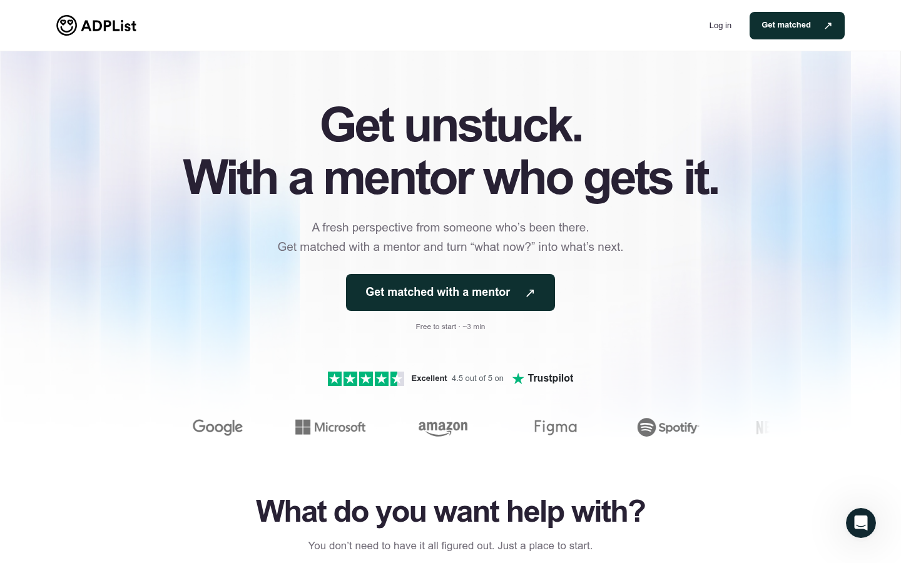
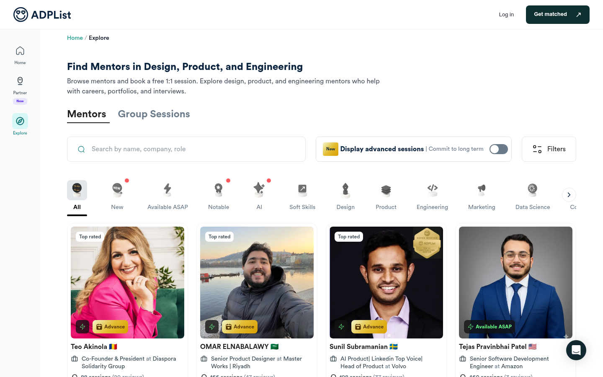
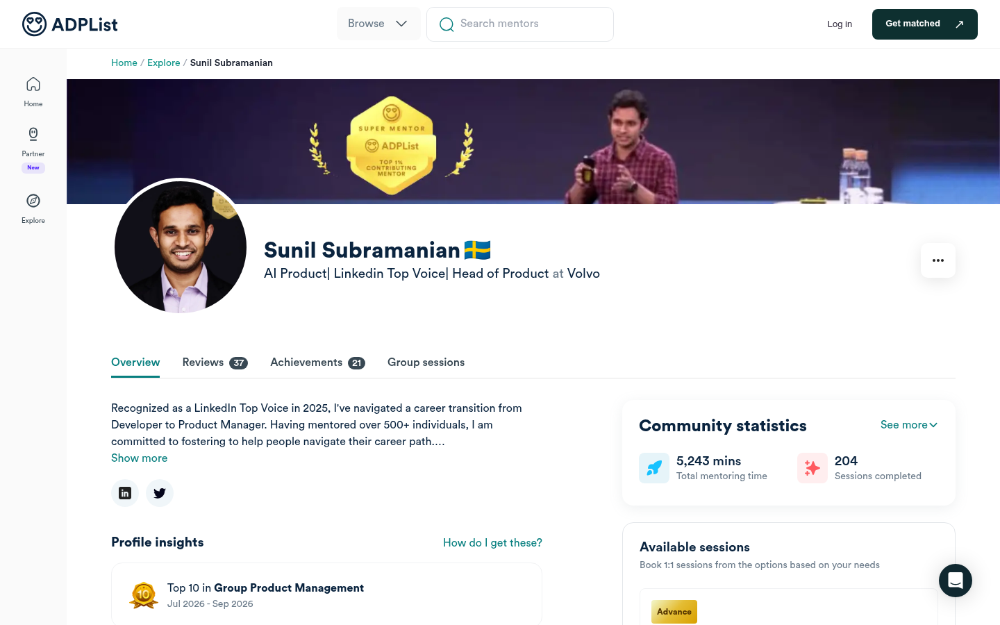
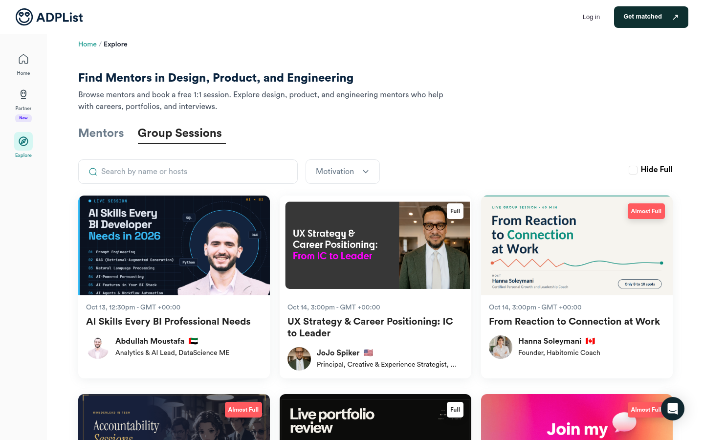
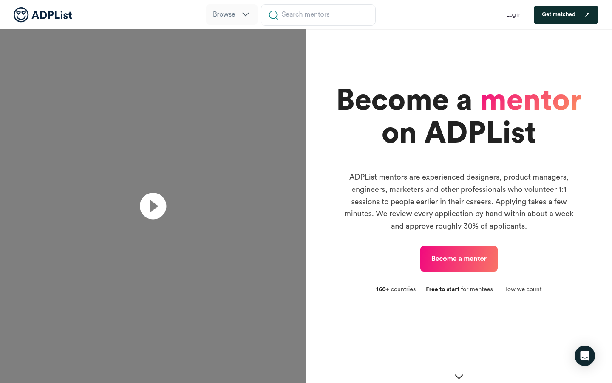

# ADPList (`adplist.org`) — Competitive UX, Community Gamification & Volunteer Ceiling Teardown

> **Threat / Benchmark Level for Familiarise**: **P1 — Top-of-Funnel Free Substitution Threat (`30,000+` Volunteer Mentors & Live Community Webinars across `160+` Countries)**  
> **Primary Surfaces Analyzed**: Global Home (`/`), Public Mentor Browse Directory (`/explore`), Public Mentor Profile with Kudos, Certificates & `Advance` Bundles (`Sunil Subramanian` — `/mentors/sunil-subramanian`), Live Community Webinars (`/explore` -> `Group Sessions`), and Volunteer Supply Onboarding (`/become-a-mentor`).

---

## 1. Executive Summary & Business Model Architecture

ADPList (`30,000+` mentors across `160+` countries, `4.5★` on Trustpilot, ~`30%` manual mentor application approval rate) dominates top-of-funnel organic search for **free 1:1 career mentorship** and **free live community webinars** in Design, Product Management, Software Engineering, Data, and AI.

Crucially, analyzing ADPList's live DOM reveals **both why experts volunteer for free AND why mentees hit a hard structural ceiling on free platforms** — a ceiling so acute that ADPList itself has begun bolting paid **`Advance` multi-session bundles** (`$19–$299`) and public **`Avg. Attendance %` warnings** onto its directory:

1. **Prestige-Driven Non-Monetary Supply Flywheel (`Achievements`, `Top 10` Certificates, `Impact Minutes`, & Structured `Kudos`)**:
   - Volunteer mentors receive zero cash for standard 30-minute sessions, yet senior leaders from Google, Meta, Amazon, Apple, Microsoft, and Volvo host hundreds of sessions (e.g., `1,898 sessions` by Shivam Gupta at Google; `204 sessions / 5,243 mentoring minutes` by Sunil Subramanian at Volvo).
   - ADPList unlocks this supply via LinkedIn-shareable social capital: quarterly **`Top 10 in <Discipline>` rankings** (_e.g., `Top 10 in Group Product Management • Jul 2026 - Sep 2026`_), cumulative **mentoring impact minutes (`5,243 mins`)**, **milestone badges (`Achievements 21`)**, and peer-validated traits (**`Clear Communicator — 100% of connections agree`**).
2. **The Volunteer Reliability Crisis (`60%–76%` Attendance Rates Exposed on `/explore`)**:
   - Because free sessions carry zero financial skin in the game for either mentor or mentee, **last-minute cancellations and ghosting are endemic**.
   - On `/explore`, ADPList explicitly prints **`Avg. Attendance`** on every single mentor card — revealing live profiles with **`60%`**, **`74%`**, and **`76%` attendance rates** (meaning **1 in 4 to 2 in 5 booked sessions fail to happen!**), alongside massive review gaps (e.g., `460 sessions` with only `3 reviews`, or `385 sessions` with `3 reviews`).
3. **The Curriculum Ceiling & ADPList's Paid `"Advance"` Bolt-On**:
   - Free 30-minute coffee chats cannot support structured multi-week career transitions, deep line-by-line document editing, or ongoing accountability.
   - To stem user graduation to paid platforms, ADPList introduced an **`Advance | Commit to long term`** toggle offering fixed weekly bundles (`2 sessions` or `4 sessions` weekly from `$19` to `$299`), validating Familiarise's core thesis that serious career execution requires paid, structured multi-week plans.

---

## 2. Strategic Comparison & Counter-Positioning: ADPList vs. Familiarise

| Architecture Dimension                     | ADPList (`adplist.org`)                                                                                                                                                 | Familiarise (`familiarise_web`)                                                                                                                               | Actionable Counter-Positioning for Familiarise                                                                                                                                                       |
| :----------------------------------------- | :---------------------------------------------------------------------------------------------------------------------------------------------------------------------- | :------------------------------------------------------------------------------------------------------------------------------------------------------------ | :--------------------------------------------------------------------------------------------------------------------------------------------------------------------------------------------------- |
| **Session Reliability & Skin in the Game** | Free 30m volunteer calls plagued by ghosting; cards must warn users of **`Avg. Attendance: 60%–76%`**                                                                   | Paid `Consultation`, `Subscription`, `Webinar`, and `Class` bookings with escrowed Razorpay payments, automated calendar sync, and refund/reschedule policies | Market **"Guaranteed Show-Up & Prepared Mentors"**: _Free coffee chats get cancelled 30% of the time. Familiarise consultants are compensated to prepare, review your docs beforehand, and show up._ |
| **Multi-Week Depth & Deliverables**        | Ad-hoc 30m chats; recently bolted on rigid **`Advance` 2- or 4-session packages** (`$19–$299`) without integrated curriculum tracking or document review workflows      | Native **`SubscriptionPlan`** (multi-month weekly cadence, structured curriculum roadmap), **`DocumentReview`** pipeline, and persistent Stream Chat channels | Contrast **"30-Minute Small Talk"** vs. **"Structured Multi-Week Transformation"** (`Curriculum + Weekly Calls + Async Document Reviews + Chat`).                                                    |
| **Live Group Events / Webinars**           | Free community **`Group Sessions`** (`/explore` -> `Group Sessions`) with strong scarcity pills (**`Full`**, **`Almost Full`**, **`Hide Full` filter**)                 | Paid & free **`WebinarPlan`** and multi-session cohort **`ClassPlan`** with live Stream Video rooms and host materials                                        | Adopt ADPList's high-converting **`Almost Full` / `Full` capacity urgency badges** and **`Hide Full` toggle** directly on `/explore/programs`!                                                       |
| **Expert Prestige & Recognition**          | Best-in-class non-monetary recognition: **`Total mentoring time (mins)`**, **`Achievements (21)`**, **`Top 10 in <Domain>` quarterly awards**, and structured **Kudos** | Consultant profile metrics, verified ratings, reviews, and **80% creator payout share**                                                                       | **Combine Prestige + Profit**: Pair Familiarise's 80/20 creator earnings with LinkedIn-shareable **Impact Milestone Cards** (_Hours Mentored, Top Rated in Domain, Verified Mentee Outcomes_).       |

---

## 3. Full Screenshot Index & Per-Screen UX Teardown

### 3.1 Landing Page & Outcome-Based Entry Doors (`https://adplist.org/`)

- **3-Door Problem Framing (`What do you want help with?`)**: Instead of asking users to pick a SKU type first, ADPList segments intent into 3 relatable emotional states:
  1. **`Get unstuck in my role`** (_Priorities, stakeholder chaos, and "what should I do next?"_)
  2. **`Switch careers / break in`** (_Portfolio, positioning, and interview reality checks from people who hire_)
  3. **`Level up my craft`** (_Sharpen skills with practitioners, not courses alone_)
- **AI Call Transcription Value Add**: Highlights automatic session recording, transcription, summary, and action items right in Trustpilot social proof.

### 3.2 Explore Mentors Directory, `Avg. Attendance %` & `Advance` Toggle (`https://adplist.org/explore`)

- **Revealing Marketplace Telemetry on Every Card**:
  - Displays country flag, `Top rated` / `Available ASAP` / `Advance` tags, `Sessions (Reviews)`, `Experience (years)`, and **`Avg. Attendance %`** (`60%` to `100%`).
  - Features the prominent **`Display advanced sessions | Commit to long term`** switch and horizontal discipline filter pills (`All`, `New`, `Available ASAP`, `Notable`, `AI`, `Soft Skills`, `Data Science`, `Design`, `Engineering`, `Marketing`, `Product`).

### 3.3 Public Mentor Profile: Kudos, Impact Minutes & `Advance` SKUs (`https://adplist.org/mentors/sunil-subramanian`)

- **Gamified Social Proof Architecture (`Sunil Subramanian — Head of Product at Volvo`)**:
  - **Tabbed Profile Navigation**: `Overview | Reviews 37 | Achievements 21 | Group sessions`.
  - **Profile Insights (`How do I get these?`)**: Highlights **`Top 10 in Group Product Management (Jul 2026 - Sep 2026)`** and **`Clear Communicator (100% of connections agree)`**.
  - **Cumulative Impact Counter**: Displays **`5,243 mins` (_Total mentoring time_)** alongside **`204` (_Sessions completed_)**.
  - **Paid `Advance` Session Cards**: Lists 6 productized weekly packages (`$19` 15m Discovery Call x2, `$39` Move to Europe Visa Guidance x2, `$99` Resume/Portfolio/LinkedIn Audit x2, `$109` Mock Interview x2, and `$299` Become an AI PM 4-session bundle).

### 3.4 Live Community Webinars / Group Sessions (`https://adplist.org/explore` — `Group Sessions`)

- **High-Velocity Community Webinar Feed**:
  - Card layout with localized date/time (`Oct 13, 12:30pm`), crisp workshop titles (_`AI Skills Every BI Professional Needs`_, _`UX Strategy & Career Positioning: IC to Leader`_, _`Live Portfolio Review: Present or Watch`_, _`Stop getting ghosted: land interviews, get offers`_), host country flag + title/company, and bold **`Full`** / **`Almost Full`** capacity badges.
  - **`Hide Full` Filter Toggle**: Lets learners immediately filter out sold-out community sessions.

### 3.5 Volunteer Mentor Onboarding & Social Capital Value Prop (`https://adplist.org/become-a-mentor`)

- **4-Step Vetting Funnel (`~30%` Approval Rate)**: `1. Apply -> 2. Review (within ~1 week, ~30% approved) -> 3. Set up your profile -> 4. Host your first session (30-min call + Send notes)`.
- **Non-Monetary Motivation Pillars**: Pitches leadership practice, global peer network across `160+` countries, press/speaking spotlights (_`Opportunities to impact`_), and organization-referred **`Partnered mentors`** badges.

---

## 4. Actionable Product & UX Takeaways for Familiarise

1. **Add LinkedIn-Shareable Prestige & Impact Badges to Consultant Profiles (`Total Hours Mentored`, `Top 5% in <Domain>`, & Structured Mentee Kudos)**: ADPList proves senior FAANG/unicorn operators are deeply motivated by status and verified impact metrics. Pairing **80% cash take-home** WITH shareable quarterly `Top Expert` certificates gives Familiarise an unbeatable supply value proposition.
2. **Surface `Almost Full` / `Spots Left` Urgency Pills & a `Hide Sold-Out` Filter on Familiarise Webinars & Classes (`/explore/programs`)**: ADPList's `Group Sessions` grid creates palpable FOMO via `Almost Full` / `Full` ribbons — directly applicable to `WebinarPlan` and `ClassPlan` cards based on `maxParticipants`.
3. **Use Explicit Anti-Ghosting Copy on Landing & Checkout Pages**: Address the #1 frustration of free mentorship refugees directly: **100% financial commitment on both sides, pre-session goal & document review, and structured multi-week roadmaps instead of random 30-minute coffee chats.**
