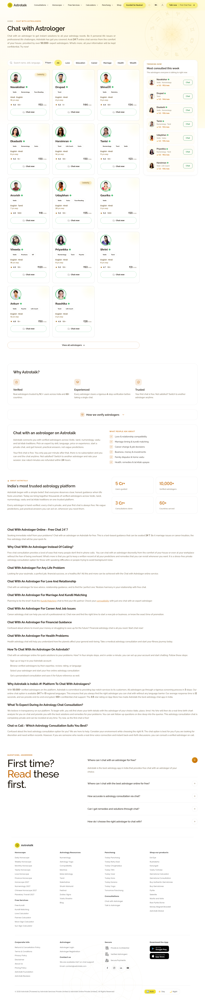
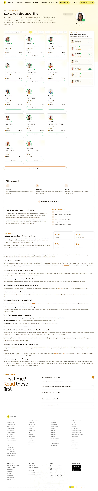
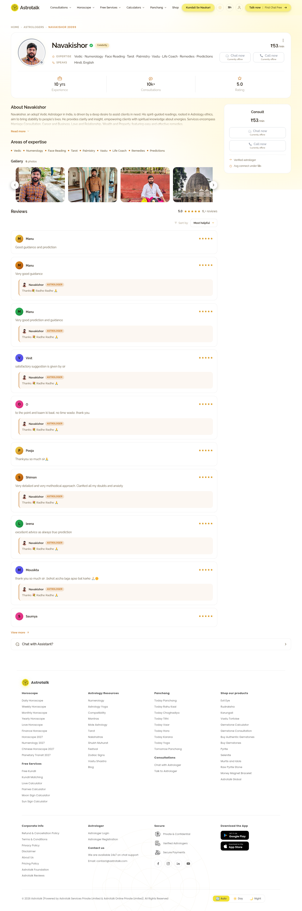

# Astrotalk (`astrotalk.com` & `astrotalk.store`) — Competitive UX, Instant Marketplace & Wallet Billing Teardown

> **Threat / Benchmark Classification for Familiarise**: **P0 Behavioral & Real-Time Conversion Benchmark (₹1,000+ Cr Run-Rate Instant 1:1 Consultation Engine)**  
> **Primary Surfaces Analyzed**: Main Landing Portal (`/`), Real-Time Chat Marketplace (`/chat-with-astrologer`), Real-Time Audio Marketplace (`/talk-to-astrologer`), Top-Rated Celebrity Consultant Storefront (`/best-astrologer/navakishor-20099`), and High-Margin Remedy & Add-On Storefront (`https://astrotalk.store/`).

---

## 1. Executive Summary & Why Astrotalk Is India's Highest-Velocity 1:1 Consultation Benchmark

While operating in a consumer vertical distinct from career/tech mentorship, **Astrotalk is India's largest real-time 1:1 human consultation marketplace by session volume and unit velocity (₹1,000+ Cr ARR)**. Where traditional mentorship platforms lose 70%+ of high-intent visitors to **scheduling latency** ("pick a slot 4 days from now, pay ₹1,500 upfront, wait for calendar invite"), Astrotalk treats emotional/career anxiety as an **instant synchronous liquidity problem**:

1. **Zero-Latency Synchronous Matching ("Chat Now / Call Now" vs. Calendar Scheduling)**: Every directory card broadcasts live presence state (`Online` green ring, `Busy • Wait ~5m` queue badge) so buyers can speak to an expert within 30 seconds of landing on the page.
2. **Prepaid Wallet Micro-Metering (`₹16/min` – `₹63/min`) + First Consultation Free Hook**: Instead of forcing an upfront ₹1,500–₹3,000 ticket commitment on a stranger, new users receive a **"First Chat Free / First Call Free"** trial hook in sticky top navigation (`Talk now | First Chat Free`) and subsequently pay per minute out of an instant UPI-recharged wallet.
3. **Extreme Social Proof Density (`10k+` orders, `5.0 ★`, `13+ Languages`, `Celebrity` tiers)**: Consultant cards surface 6 high-signal attributes in a compact 2-column grid—eliminating decision paralysis across thousands of supply profiles.
4. **High-Margin Post-Consultation Remedy Cross-Sell (`astrotalk.store`)**: Live 1:1 sessions naturally diagnose problems whose structured remedies (certified gemstones, bracelets, reports, pujas) are cross-sold directly in chat transcripts and the top-level `Shop` portal.

---

## 2. Marketplace Mechanics & Unit Economics Comparison vs. Familiarise

| Dimension                                | Astrotalk (`astrotalk.com`)                                                                                                                                                    | Familiarise (`familiarise_web`)                                               | Actionable Lesson for Familiarise                                                                                                                                              |
| :--------------------------------------- | :----------------------------------------------------------------------------------------------------------------------------------------------------------------------------- | :---------------------------------------------------------------------------- | :----------------------------------------------------------------------------------------------------------------------------------------------------------------------------- |
| **Session Initiation Latency**           | **Instant synchronous queue (`0–5 min wait`)** — live green `Chat now` / `Call now` triggers                                                                                   | Scheduled slot booking (`ConsultationPlan` / `SubscriptionPlan` future slots) | Introduce an opt-in **"Available Now / Instant 15-Min Quick Consult"** presence toggle + green status badge on `/explore/experts` for online consultants.                      |
| **First-Time Buyer Conversion Hook**     | **"First Chat / Call Free"** banner + low entry per-minute rates (`₹16/min` to `₹63/min`)                                                                                      | Full upfront session fee or consultant-defined free plan                      | Highlight a dedicated **"Free 15-Min Intro / First Session ₹99"** filter & badge prominently in the header and hero directory.                                                 |
| **Pricing Unit & Psychological Framing** | **Per-minute metered wallet (`₹20/min`, `₹34/min`, `₹53/min`)**; zero cognitive shock                                                                                          | Total package/session lump sum (`₹1,500` for 45 mins = `₹33/min` equivalent)  | Display **per-session breakdown** on multi-session `SubscriptionPlan` cards (e.g., _"₹699/session across 8 sessions"_ alongside total price) to anchor unit affordability.     |
| **Card Trust Signals**                   | Verified rating (`4.9 ★`–`5.0 ★`), bucketed order volume (`500+`, `1k+`, `5k+`, `10k+`), experience (`10 yrs exp`), languages (`Hindi · English`), and tier pill (`Celebrity`) | Domain, experience, rating, headline                                          | Surface **completed session count buckets (`50+ sessions`, `100+ sessions`)** and spoken language pills directly on `/explore/experts` cards.                                  |
| **Post-Session Upsell / LTV Expansion**  | Prescriptive remedy links (`astrotalk.store`) embedded directly into post-call summaries                                                                                       | Standalone plans on consultant profile                                        | After a 1:1 `Consultation`, automatically prompt the consultant to recommend a structured follow-up `SubscriptionPlan` or `ClassPlan` inside the post-call summary email/chat. |

---

## 3. Full Screenshot Index & Per-Screen UX Teardown

### 3.1 Main Portal Hero, Intent Cards & Free Diagnostic Funnel (`https://astrotalk.com/`)

- **Dual Primary Action Cards Above the Fold**: Immediate high-contrast action tiles (`Chat with Astrologer — Instant text consultation`, `Call Astrologer`, `Daily Horoscope`, `Get Free Kundli`) paired with a sticky header pill (`Talk now | First Chat Free`).
- **Problem-First Category Routing**: Horizontal life-problem cards (`Love`, `Marriage & Kundli`, `Career`, `Women astrologers`, `Business & Money`, `Health & Family`) route buyers straight to pre-filtered expert cohorts rather than forcing taxonomy guesswork, backed by 20+ free SEO calculators (`freekundli`, `kundali-se-naukari`) that capture organic search intent at zero CAC.

### 3.2 Real-Time Chat Consultation Directory (`https://astrotalk.com/chat-with-astrologer`)

- **"Most Consulted This Week" Horizontal Rail**: Top horizontal carousel spotlights high-converting consultants (`Navakishor ₹53/min`, `Drupad ₹44/min`, `Ekadashi ₹30/min`, `Tanisi ₹23/min`, `Priyankka ₹63/min`) with one-tap `Chat` buttons.
- **High-Density 3-Column Expert Cards**: Each card packs avatar + green online dot + tier badge (`Celebrity`), primary sub-skills (`Vedic · Numerology · Face Reading`), spoken languages (`Hindi · English`), tenure (`10 yrs exp`), rating + order volume (`5.0 · 10k+`), rate (`₹53/min`), and green `Chat now` CTA in under 140px height.

### 3.3 Real-Time Audio Call Directory (`https://astrotalk.com/talk-to-astrologer`)

- **Language-First Acquisition Headline**: Explicitly merchandises _"First Call Free in 13+ Languages"_ (`English`, `Hindi`, `Tamil`, etc.) with lower-friction entry rates (`₹16/min` – `₹25/min`) tailored to voice-first tier-2/tier-3 Indian buyers.
- **Identical Card Skeleton Across Modalities**: Switching between `Chat` and `Call` preserves the exact card grid layout, filter bar, and rate structure—minimizing UI re-learning.

### 3.4 Consultant Storefront, Bio & Verified Review Histogram (`https://astrotalk.com/best-astrologer/navakishor-20099`)

- **Focused Profile Layout**: Clean two-column split with sticky profile card on left (avatar, `Celebrity` badge, languages, years of experience, `₹53/min`, dual `Chat now` / `Call now` buttons) and structured sections on right (`About Navakishor`, `Areas of expertise`, `Gallery`, and verified `Reviews` feed with star breakdown).
- **Zero Off-Platform Leakage**: No external social links or off-platform contact handles; all engagement is funneled into instant platform chat/voice sessions.

### 3.5 Cross-Sell Remedy & Digital/Physical Add-On Storefront (`https://astrotalk.store/`)

- **Purpose- & Outcome-Driven Merchandising**: Organized by `Shop by Purpose` (Career, Wealth, Relationships), `Shop by Planet`, and `Best Sellers` (`Metal Dhan Yog Bracelet`, `Zodiac Rings`), turning transient 10-minute chat sessions into high-AOV repeat commerce.

---

## 4. Concrete Product Recommendations for Familiarise

1. **"Available Today / Instant 15-Min Slot" Presence Filter on `/explore/experts`**: Add a quick filter pill (`Available Today` / `Next 2 Hours`) backed by existing `SlotOfAvailabilityWeekly` + `SlotOfAvailabilityCustom` calculations so urgent career seekers can book an immediate same-day session without clicking through 6 empty profiles.
2. **Per-Session Effective Price Anchor on Multi-Week Subscriptions & Classes**: Render `₹X / session` prominently beside total plan price on `SubscriptionPlan` and `ClassPlan` cards to capture Astrotalk's unit-price transparency without needing complex per-minute wallet billing.
3. **Consultant-Recommended Follow-Up Card in Stream Chat**: Allow consultants inside a 1:1 session chat channel to send a rich one-click **"Recommended Next Step Plan"** card (`SubscriptionPlan` / `WebinarPlan` / `ClassPlan`) that opens pre-selected checkout—replicating Astrotalk's high-converting remedy prescription loop cleanly inside Familiarise's existing Razorpay checkout flow.
