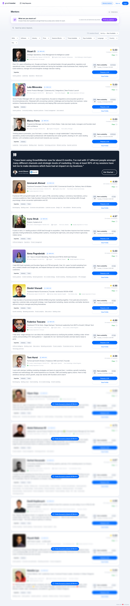
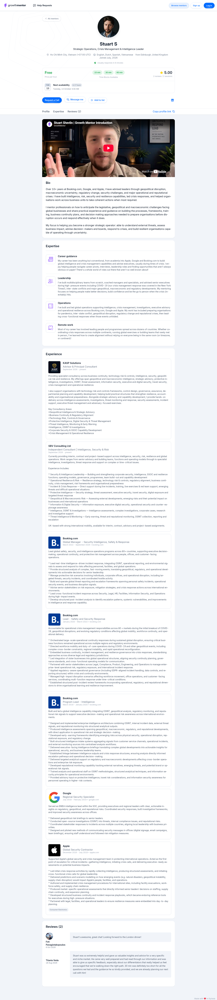
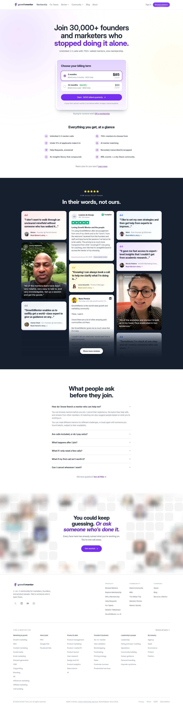

# GrowthMentor (`growthmentor.com`) — Competitive UX, Flat-Fee Membership Economics & Reverse-Pitch Teardown

> **Threat / Benchmark Level for Familiarise**: **P1 — Global Counter-Positioning Benchmark for All-You-Can-Eat Seeker Memberships & Reverse-Pitch "Help Requests"**  
> **Primary Surfaces Analyzed**: Global Home (`/`), Interactive Mentor Browse Directory (`/search` & `/mentors-for`), Live Practitioner Profile (`Stuart S` — `/mentors/stuart-shevlin`), Seeker Membership Pricing (`/membership`), Reverse-Pitch Board (`/help-requests`), and Mentor Supply Onboarding (`/become-a-mentor`).

---

## 1. Executive Summary & Business Model Architecture

GrowthMentor (`750+` vetted startup operators, `< 5%` applicant acceptance rate, `62,000+` sessions completed, `4.8★` across `30,247` reviews) represents the purest global example of **flat-rate seeker subscription + reverse demand matching**:

1. **Flat-Fee "All-You-Can-Eat" Seeker Membership (`$50–$85/mo` = `$0` Per Call)**:
   - Instead of charging per call or per mentor retainer, GrowthMentor charges founders/marketers/PMs a single membership subscription:
     - **Quarterly (`3 months`)**: **`$85 / month`** (`$255` billed every 3 months)
     - **Annual (`12 months`, `Save 41%`)**: **`$50 / month`** (`$600` billed annually)
   - Backed by a **14-day full money-back guarantee** (_"If your first call isn't worth it, full refund within 14 days. Cancel anytime"_).
   - Over 90%+ of mentors set their session fee to **`Free` (`$0` per hour for members)** across `15 min`, `30 min`, and `60 min` blocks; mentors who choose to charge extra keep **100% (`0%` platform commission take rate)**.
2. **Reverse-Pitch Demand Board ("Help Requests" — `/help-requests` & `/opportunities`)**:
   - Solves seeker choice paralysis (_"With this many mentors, the hard part is choosing. So you don't. You say what you're stuck on, and the mentors who can help come find you."_).
   - Members post **1 active structured request at a time** categorized across **6 ask types**:
     1. **`Mentorship`** (_Get a real opinion_)
     2. **`Feedback`** (_Pressure-test a thing_)
     3. **`Partnership`** (_Find someone to build with_)
     4. **`Intro`** (_Get a warm introduction_)
     5. **`Networking`** (_Meet people in your lane_)
     6. **`Hire`** (_Find a first hire_)
   - Vetted practitioners pitch how they solved that exact problem (e.g., _3 senior GTM leaders applying within 2 hours to pressure-test a first-time Head of Marketing's 30-60-90 plan_), inverting cold outreach into high-intent inbound matching.
3. **Explicit Anti-Retainer Positioning (GrowthMentor's Structural Ceiling)**:
   - On `/become-a-mentor`, GrowthMentor explicitly tells practitioners:
     > _"No retainers. No long engagements. No 'let's hop on a quick call' turning into a six-month commitment... There's no call requirement. None... If a week comes when you can't do it, you can't do it. That's fine. The mentees who needed help that week will book someone else."_
   - While great for casual brainstorming (_"Bring the mess. Leave with a decision"_), this creates **unlimited-call roulette**: mentees repeat their backstory from scratch to a new stranger every week, receive zero structured multi-week curriculum, and cannot hold any single expert accountable for end-to-end career or business execution.

---

## 2. Strategic Comparison & Counter-Positioning: GrowthMentor vs. Familiarise

| Architecture Dimension           | GrowthMentor (`growthmentor.com`)                                                                                                                                                     | Familiarise (`familiarise_web`)                                                                                                                                         | Familiarise Strategic Counter-Positioning                                                                                                                                                          |
| :------------------------------- | :------------------------------------------------------------------------------------------------------------------------------------------------------------------------------------ | :---------------------------------------------------------------------------------------------------------------------------------------------------------------------- | :------------------------------------------------------------------------------------------------------------------------------------------------------------------------------------------------- |
| **Monetization & Take Rate**     | Flat seeker membership (`$85/mo` quarterly or `$50/mo` annual) + **`0%` commission** on optional mentor hourly rates                                                                  | **80/20 Creator Economics**: Consultants set their own INR pricing on `ConsultationPlan`, `SubscriptionPlan`, `WebinarPlan`, and `ClassPlan` (retaining **80%** payout) | Flat-fee unlimited models starve top mentors of recurring income unless they covertly pitch agency retainers. Familiarise pays experts transparently so top practitioners dedicate real prep time. |
| **Continuity vs. Call Roulette** | **Ad-hoc `15 / 30 / 60 min` calls** across dozens of disconnected mentors; mentors toggle `"I'm out"` anytime with zero continuity                                                    | **Dedicated Multi-Week `SubscriptionPlan`s** (`callsPerWeek`, structured weekly topics, continuous Stream Chat + async document reviews with **one committed expert**)  | Position Familiarise directly against _"15-minute advice tourism"_: **stop re-explaining your career context to 10 strangers — build a multi-week roadmap with one accountable expert.**           |
| **Discovery & Matching**         | Faceted `/search` + AI matching + **Reverse-Pitch `Help Requests`** (`Mentorship`, `Feedback`, `Intro`, `Hire`)                                                                       | Faceted expert discovery (`/explore/experts`), domain/tag filtering, `TrialSession` chemistry check, and direct plan checkout                                           | Adding a lightweight **"Post a Learning / Mentorship Goal" request board** (or structured intake prompt routed to matching verified consultants) captures undecided buyers before bounce.          |
| **Mentor Scheduling Controls**   | **`"I'm out"` vacation switch** + **`Weekly call cap (e.g., 2/wk)`** + calendar busy auto-blocking + mandatory booking question preview (_"You see the question before you say yes"_) | Weekly/custom availability slots (`SlotOfAvailabilityWeekly`, `SlotOfAvailabilityCustom`), `Appointmentlock` mutex, and pre-call context                                | Exposing a 1-click **"Pause New Bookings / Vacation Mode" toggle** and **Weekly Session Cap** on the Consultant Dashboard removes fear of calendar overload for senior IC/VP supply.               |

---

## 3. Full Screenshot Index & Per-Screen UX Teardown

### 3.1 Landing Page & Anti-Solo-Grind Positioning (`https://www.growthmentor.com/`)

- **Editorial Hero Copy**: Leads with emotional founder relief (_`"Growth gets easier when you talk it through."`_ / _`"One subscription. Unlimited calls."`_ / _`"Bring the mess. Leave with a decision."`_) backed by `4.8★` social proof across `30,000+` founders/marketers, AI call recaps (_`"You hang up. The call keeps working."`_), and quarterly (`$255`) vs. annual (`$600`) transparent billing cards.

### 3.2 Interactive Mentor Directory & Availability Cards (`https://www.growthmentor.com/search`)

- **High-Signal Browse Grid**: Clean practitioner cards featuring operator headshots, company history logos (`Google`, `Apple`, `Booking.com`, `Amazon`, `Meta`), response-speed badges, `$0 / Free` vs. paid session indicators, and curated topic collections (`/collections` & `/mentors-for`).

### 3.3 Live Practitioner Profile Card & Zero-Fee Call Booking (`https://www.growthmentor.com/mentors/stuart-shevlin`)

- **Conversion Metadata on `Stuart S` (_Strategic Operations, Crisis Management & Intelligence Leader — ex-Booking.com, Google, Apple_)**:
  - **Hyper-Responsive SLA Badge**: **`Usually responds in 8 minutes`** + timezone transparency (`Ho Chi Minh City, Vietnam (+07:00 UTC)`).
  - **Session Packaging Card**: Displays **`Free`** (_Price per hour_), selectable **`15 min | 30 min | 60 min`** time blocks, **`Next availability: in 17 hours`**, and primary CTA **`Request a Call`** paired with **`Message me`** and **`Add to list`**.
  - **Structured Topic-Specific Bio Sections**: Instead of one generic wall of text, expertise is broken down by specific mentorship pillars (`Career guidance`, `Leadership`, `Operations`, `Remote work`) explaining how the mentor helps on each specific topic.

### 3.4 Seeker Membership Pricing & Risk-Reversal (`https://www.growthmentor.com/membership`)

- **2-Card Billing Term Selector**: Contrasts **`3 months — $85/month ($255 total)`** against **`12 months — Save 41% — $50/month ($600 total)`**, anchored by a **14-day full refund guarantee**, gift membership option (`/gift`), and team plan upsell (`/for-teams`).

### 3.5 Mentor Supply Onboarding & Anti-Burnout Controls (`https://www.growthmentor.com/become-a-mentor`)

- **Interactive Booking Request UI Preview**: Shows prospective mentors an actual incoming request card (_`"Tripled the ad budget, got 1.5x the customers. Why?" — 30 min • Paid acquisition • Accept / Decline`_) with the tagline **`"You see the question before you say yes."`**
- **Explicit Calendar Protection UI Mockup**: Visualizes the 3 controls every busy operator wants before onboarding: **`"I'm out" switch`**, **`Weekly call cap (2 / week)`**, and **`Calendar sync (Connected)`**.

---

## 4. Actionable Product & UX Takeaways for Familiarise

1. **Require a Structured 1-Sentence _"What Do You Want to Solve?"_ Intake Prompt Before Trial / Consultation Confirmation**: GrowthMentor's `"You see the question before you say yes"` card dramatically boosts mentor acceptance rates and call quality. Requiring consultees to state their concrete goal at booking time makes every Familiarise consultation feel high-signal.
2. **Add `Weekly Session Cap` + `1-Click Pause / Vacation Toggle` to Consultant Availability Settings**: Senior practitioners hesitate to join marketplaces because they fear calendar spam during product launches. Surfacing a simple weekly cap + vacation toggle in `/dashboard/consultant/[consultantId]` directly removes supply onboarding friction.
3. **Break Consultant Bios into Topic-Specific Value Cards**: Encourage consultants to structure profile descriptions by outcome pillar (e.g., _System Design Prep_, _IC-to-EM Transition_, _Resume & Portfolio Positioning_) rather than a generic CV summary.
