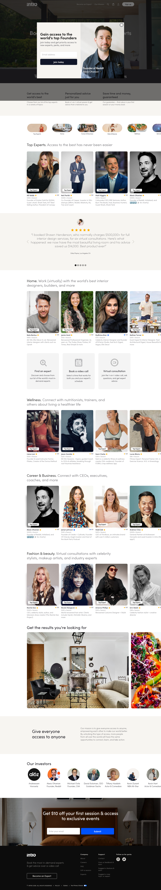
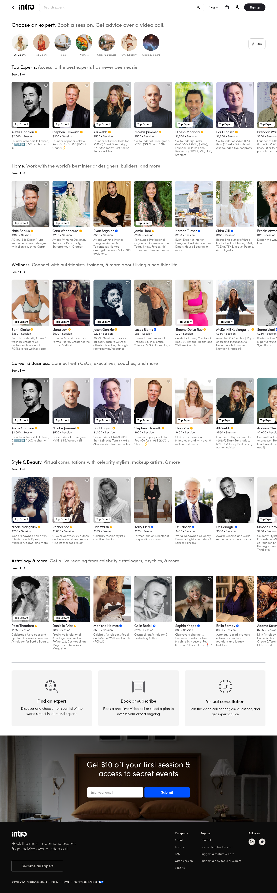
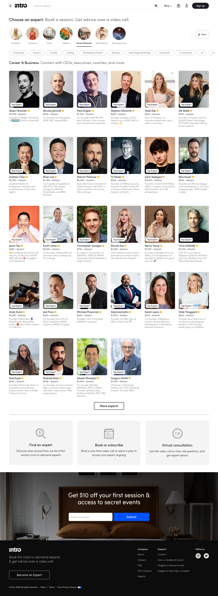
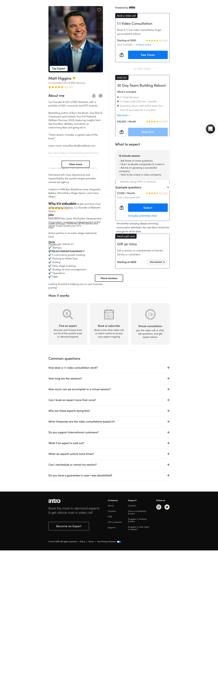
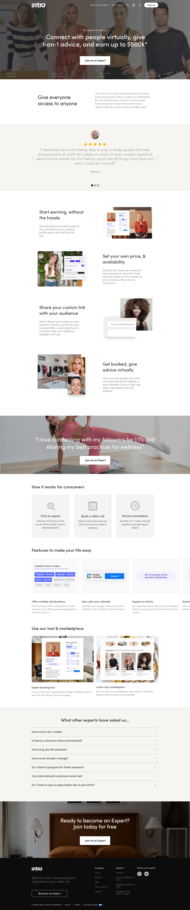

# Intro (`intro.co`) — Competitive UX, High-AOV Booking Funnel & Advisory Retainer Teardown

> **Threat / Benchmark Level for Familiarise**: **P0 — Global Flagship UX & PM Benchmark ("Airbnb for 1:1 Video Consultations")**  
> **Primary Surfaces Analyzed**: Consumer Landing Page (`/`), Marketplace Explore Directory (`/marketplace`), Career & Business Consulting Vertical (`/marketplace?topic=Career%20%26%20Business`), Live High-Demand Expert Booking Profile (`Matt Higgins` — `/matthiggins`), and Supply Acquisition Landing Page (`/experts`).

---

## 1. Executive Summary & Business Model Architecture

Intro positions itself globally as **"Book the world's most in-demand experts & get 1:1 advice over a video call"** across Startups, Career, Fundraising, Design, E-Commerce, Wellness, and Executive Leadership — directly mirroring Familiarise's core consumer value proposition as **"Airbnb for expertise"**. Rather than competing on low-ticket commodity tutoring, Intro optimizes every square inch of its product around **ultra-high Average Order Value (`$150` to `$7,500+` per single session, and `$7,000–$10,000/month` executive advisory retainers)** through three core business & UX mechanics:

1. **Dual-Tier Take-Rate Split (Marketplace Discovery vs. Direct Creator Link)**:
   - **Marketplace Discovery Bookings (`~25%–30%` Take Rate)**: When demand is acquired organically or via paid acquisition through `intro.co/marketplace` and topic directories, Intro captures a high marketplace take-rate (~25–30%) on the first booking.
   - **Direct Shareable Link (`~10%` Take Rate)**: When an expert embeds their direct URL (`intro.co/<ExpertName>`) on their personal bio, newsletter, or X/LinkedIn profile ("Share your custom link with your audience"), Intro reduces the fee to ~10% — incentivizing top-1% operators (`Alexis Ohanian`, `Matt Higgins`, `Andrew Chen`, `Alli Webb`, `Nikita Bier`) to use Intro as their primary monetization link.
2. **Real-Time In-Call Paid Extensions & Charity Philanthropy Hooks**:
   - **In-Session Paid Call Extensions**: Near the end of a live video consultation, Intro prompts the buyer directly inside the video room to pay per-minute/block to extend the session live (`"Offer call extensions: Intro will ask the customer if they would like to pay to extend the session & help you earn more"`).
   - **Charity Proceeds Badges**: Ultra-wealthy founders who are price-insensitive (`Alexis Ohanian`, `Paul English`, `Andrew Chen`) toggle a verified **5%–100% Charity Donation Banner** (`"100% of proceeds will be donated to 776 Foundation"`), converting status/philanthropy into supply liquidity.
3. **Hybrid Single-Call + High-Ticket Monthly Advisory Subscriptions + Gift Cards**:
   - While known for 15–60 minute 1:1 calls, Intro profiles seamlessly stack **Monthly Advisory Plans** (`$7,000/mo` — `90 min/mo 1:1 Video Calls + Unlimited Premium 1:1 Chat`) and **Gift Cards** (`"Gift an Intro — Starting at $500"`) directly beneath the primary video call booking card.

---

## 2. Funnel, Pricing & UX Comparison: Intro (`intro.co`) vs. Familiarise (`familiarise_web`)

| Product / UX Dimension                 | Intro (`intro.co`)                                                                                                                                                                                                                  | Familiarise (`familiarise_web`)                                                                                    | Strategic Takeaway for Familiarise                                                                                                                                                  |
| :------------------------------------- | :---------------------------------------------------------------------------------------------------------------------------------------------------------------------------------------------------------------------------------- | :----------------------------------------------------------------------------------------------------------------- | :---------------------------------------------------------------------------------------------------------------------------------------------------------------------------------- |
| **Card Density & Authority Signals**   | Minimalist portrait photo + `Top Expert` badge + `5.0` rating + transparent `$500 • Session` price + punchy 1-line exit/outcome bio (`"Co-founder of KAYAK (IPO then $2B exit)"`, `"Founder of PillPack (acq. by Amazon for $1B)"`) | Consultant card with photo, domain/subdomains, company logo, experience years, rating, and pricing                 | Lead consultant headlines with **concrete career outcomes / exits / domain pedigree** rather than generic job titles to justify higher session rates.                               |
| **Availability Urgency & Slot UX**     | Live dynamic urgency badge directly on the primary CTA card: **`Next available — 8:00pm today`** (`See times`), or **`Sessions sold out! -> Join the waitlist`**                                                                    | Multi-step slot selection modal / calendar picker on consultant profile                                            | Surfacing **`Next available — Today, 8:00 PM`** (from `SlotOfAvailabilityWeekly` / `SlotOfAvailabilityCustom`) directly on the expert profile card boosts immediate booking intent. |
| **Single Call vs. Retainer Packaging** | Primary card = **1:1 Video Consultation (`Starting at $500`)**, followed immediately by **`or select a plan`** (`1:1 Chat + 90–120 min/mo Video Calls` at `$7k–$10k/mo` with `Only a few spots left!` scarcity pill)                | Separate `ConsultationPlan` (1-off), `SubscriptionPlan` (multi-week), `WebinarPlan`, and `ClassPlan` tabs/sections | Stacking a clear **"1:1 Consultation -> Ongoing Monthly / Multi-Week Advisory"** visual hierarchy helps single-session buyers self-upgrade into recurring subscriptions.            |
| **Gifting & Viral Acquisition**        | Dedicated **`Gift an Intro`** card embedded on every expert profile & navbar (`"Gift a session or membership to friends, family, or coworkers"`)                                                                                    | Direct buyer checkout only (`Payment` -> `Appointment`)                                                            | Gifting consultations/mentorship packages is a high-AOV, zero-CAC referral mechanism around graduations, promotions, and startup launches.                                          |

---

## 3. Full Screenshot Index & Per-Screen UX Teardown

### 3.1 Consumer Home & Celebrity Operator Showcase (`https://intro.co/`)

- **Above-the-Fold Clarity**: Instant headline positioning (_"Book the world's most in-demand experts & get advice over a video call"_) backed by horizontal category pills (`Top Experts`, `Career & Business`, `Home`, `Style & Beauty`, `Wellness`, `Astrology & more`) and high-trust operator cards (`Alli Webb $450`, `Neil Parikh $2,500`, `Matt Higgins $500`, `Alexis Ohanian $2,000`, `Andrew Chen $2,000`).

### 3.2 Marketplace Explore Directory (`https://intro.co/marketplace`)

- **Frictionless Browse & Instant Price Transparency**: Clean 4-column card grid displaying upfront per-session pricing (`$80` to `$6,500 • Session`), `Top Expert` pills, star ratings, and instant `See Times` hover actions without requiring account creation.

### 3.3 Career & Business Consulting Vertical (`https://intro.co/marketplace?topic=Career%20%26%20Business`)

- **High-Signal Founder & Executive Roster**: Curates unicorn founders and VC general partners (`Alexis Ohanian`, `Paul English`, `Andrew Chen`, `Brian Lee`, `Shervin Pishevar`, `TJ Parker`, `Zach Yadegari`) with quantifiable exit proof right in the 2-line card subtitle.

### 3.4 Expert Profile, Live Availability Urgency & Monthly Retainer Tiers (`https://intro.co/matthiggins`)

- **Split Two-Column High-Conversion Layout**:
  - **Left Column**: Portrait hero media, verified `5.0 (87)` rating, crisp bulleted `"Things I can advise on"` checklist (`Startups`, `Scaling`, `Early-stage investing`, `M&A`), `"What to expect (15 minute session)"`, and `"Example questions"`.
  - **Right Column (Sticky Booking Stack)**:
    1. **1:1 Video Consultation (`Starting at $500`)** with **`Next available — 8:00pm today`** and primary `See times` CTA.
    2. **Monthly Advisory Plans (`or select a plan`)**: Tiered `$10,000 / Month` (`Sold Out` scarcity badge) and `$7,000 / Month` (`Only a few spots left!`, `1:1 Chat (Premium) + 90 min/mo Video Calls`).
    3. **Gift Card Upsell (`Gift an Intro — Starting at $500`)**.

### 3.5 Supply Onboarding & Creator Monetization Pitch (`https://intro.co/experts`)

- **White-Glove Supply Onboarding**: Headlines `"Connect with people virtually, give 1-on-1 advice, and earn up to $500k*"`, emphasizing Concierge Profile Setup (_"We will build your profile page for you"_), flexible session lengths (`15 min to 3 hours`), Google Calendar two-way sync, charity donation splits (`5–100%`), and paid live call extensions.

---

## 4. Actionable Product & UX Takeaways for Familiarise

1. **Surface Dynamic `"Next Available: Today, 8:00 PM"` Urgency Badges on Expert Cards & Sticky Booking Panels**: Computing the earliest open slot from `SlotOfAvailabilityWeekly`/`SlotOfAvailabilityCustom` and displaying it above the primary booking CTA removes uncertainty and accelerates checkout conversion.
2. **Add Structured `"What to Expect"` & `"Example Questions to Ask"` Blocks to Consultant Profiles**: First-time buyers hesitate when booking ₹1,500–₹10,000 consultations because they aren't sure what can be accomplished in 30–60 minutes; 3–4 sample questions per domain immediately eliminate buyer friction.
3. **Highlight Philanthropy / Charity Cause Badges Optionality for Senior Executives**: Allowing senior C-suite/VP mentors to display an optional charity pledge badge unlocks supply who wouldn't otherwise monetize 1:1 time for personal pocket money.
