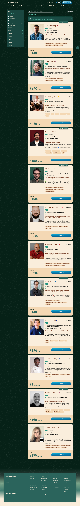
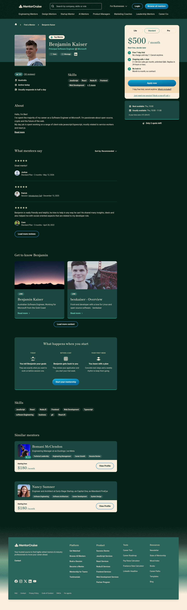
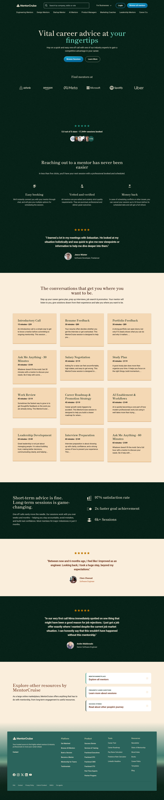
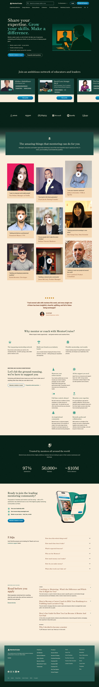

# MentorCruise (`mentorcruise.com`) — Competitive UX, Retainer Tier Design & Hybrid SKU Teardown

> **Threat / Benchmark Level for Familiarise**: **P0 — Global Flagship Benchmark for Recurring Mentorship Retainers + 1:1 Session SKUs**  
> **Primary Surfaces Analyzed**: Global Home (`/`), Faceted Mentor Directory (`/mentor/browse/`), Live Star Mentor Profile with `Lite / Standard / Pro` Retainers + `7-Day Free Trial` (`Benjamin Kaiser` — `/mentor/benjaminkaiser/`), Standardized 1:1 Single Sessions Marketplace (`/sessions/`), and Mentor Onboarding & Pricing Page (`/mentor/`).

---

## 1. Executive Summary & Business Model Architecture

MentorCruise (`7,300+` vetted global mentors across Engineering, Product, Design, Data/AI, Leadership, and Growth) is the single closest global architectural analog to **Familiarise (`familiarise_web`)**. Unlike ad-hoc creator link tools that only sell standalone calls, MentorCruise pioneered the exact **dual-engine monetization architecture** built into Familiarise's database schema (`SubscriptionPlan` + `ConsultationPlan` + `TrialSession` + Stream Chat + Document Reviews):

1. **Standardized 3-Tier Monthly Retainer Packaging (`Lite` / `Standard` / `Pro`)**:
   - Every mentor profile presents clean tabbed monthly subscription plans (`$140/mo` to `$600+/mo`) bundling **Async Unlimited Chat Q&A (`< 24h` SLA)** + **Scheduled Monthly Video Calls (`2x–4x 60-min calls/mo`)** + **Hands-On Code / Resume / Document Reviews**.
   - **Month-to-Month Zero Lock-In (`Cancel anytime`)**: Rather than forcing upfront 6-month lump-sum invoices, MentorCruise bills monthly recurring retainers with explicit `"No lock-in — Month to month, no contract"` trust framing.
2. **Universal `7-Day Free Trial` Conversion Engine (`Start free, decide later`)**:
   - Every subscription application opens with a **zero-risk 7-day trial** (`"Free 7-day trial: No charge until day 7. Cancel anytime"`), during which the mentee outlines their goals (`TODAY`), gets matched/accepted by the mentor (`WITHIN A DAY`), and establishes a concrete roadmap (`YOUR FIRST WEEK`) before billing starts.
3. **Standardized Fixed-Price One-Off Sessions Catalog (`/sessions/`)**:
   - For buyers who aren't ready for a monthly subscription (`"Just need one session? Book a one-off call →"`), MentorCruise offers **11 productized, fixed-duration, fixed-price session SKUs** (`Introductory Call — 15m • $39`, `Resume Feedback — 30m • $89`, `Portfolio Feedback — 30m • $89`, `Salary Negotiation — 45m • $119`, `System Design / Interview Prep — 60m • $149`), backed by a **24-hour full money-back guarantee**.
4. **Transparent ~16.6% Platform Fee (`83.4%` Creator Take-Home)**:
   - MentorCruise positions itself transparently between low-touch link tools and heavy 30–50% marketplaces by charging a flat platform commission (~16.6% fee on subscriptions/sessions) while handling global payouts across 90+ countries, dispute protection, trial management, and recurring invoicing.

---

## 2. Product, Tiering & Funnel Comparison: MentorCruise vs. Familiarise

| Architecture Dimension                | MentorCruise (`mentorcruise.com`)                                                                                                                                                   | Familiarise (`familiarise_web`)                                                                                                                     | Actionable Opportunity for Familiarise                                                                                                                                                                 |
| :------------------------------------ | :---------------------------------------------------------------------------------------------------------------------------------------------------------------------------------- | :-------------------------------------------------------------------------------------------------------------------------------------------------- | :----------------------------------------------------------------------------------------------------------------------------------------------------------------------------------------------------- |
| **Recurring Subscription Tiers**      | Tabbed **`Lite` / `Standard` / `Pro`** monthly plans on every profile (`$140–$500/mo`) with itemized call quotas (`2 × 60-min calls/mo`) + SLA (`Replies in 24 hours or less`)      | `SubscriptionPlan` model with custom duration (`durationInMonths`), `callsPerWeek`, `sessionDurationInHours`, `emailSupport`, and curriculum topics | Presenting **Good / Better / Best (`Lite / Standard / Pro`)** side-by-side plan tabs with explicit chat SLA & monthly session counts makes comparing consultant plans effortless.                      |
| **Risk-Reversal / Trial Loop**        | **Universal `7-Day Free Trial` (`No charge until day 7`)** + 3-step visual onboarding timeline (`TODAY -> WITHIN A DAY -> YOUR FIRST WEEK`)                                         | `TrialSession` booking (`Appointment` linked to `Subscription` conversion flow)                                                                     | Pairing Familiarise's `TrialSession` with a crisp **3-step `"What happens when you start"` timeline** (`Day 1 Goals -> Trial Call -> Weekly Plan`) directly addresses subscription commitment anxiety. |
| **One-Off Consultation SKUs**         | Standardized **Outcome-Named Session Catalog** (`15m Intro $39`, `30m Resume Review $89`, `45m Salary Negotiation $119`, `60m Interview Prep $149`)                                 | Consultant-defined `ConsultationPlan`s (`durationInHours`, `price`, `title`, `description`)                                                         | Offering **1-click pre-filled SKU templates** during consultant onboarding (_Resume Audit, Mock Interview, System Design, Career Roadmap_) eliminates blank-page setup friction and improves SEO.      |
| **Scarcity & Responsiveness Signals** | Live badges on profile & directory cards: **`Active today`**, **`Usually responds in half a day`**, **`Only 2 spots left!`**, and review plan tags (**`Standard Plan • 3 months`**) | Consultant availability slots, rating count, and review list                                                                                        | Tagging verified reviews on Familiarise with the actual plan completed (e.g., **`8-Week Subscription`**, **`1:1 Consultation`**, **`Webinar`**) adds massive authenticity to social proof.             |

---

## 3. Full Screenshot Index & Per-Screen UX Teardown

### 3.1 Global Home Page & Dynamic Role Typeahead (`https://mentorcruise.com/`)

- **Interactive Category Search & AI Matchmaker**: Combines instant search/skill pills (`Product Managers`, `Career Coaches`, `Software Engineers`, `UX Designers`, `Data Scientists`, `Startup Founders`) with pre-populated AI match prompts (`/match/?draft=...`) and outcome case studies (`Software Engineer at Tesla`, `Data Scientist at Printify`).

### 3.2 Faceted Mentor Directory & Scarcity Cards (`https://mentorcruise.com/mentor/browse/`)

- **High-Signal Horizontal Search Cards**: Filters across `Skills (Leadership 512, Career Growth 484, Product Management 326)`, `Job titles`, `Companies`, `Languages`, and `Price range`. Each card displays country flag, `Top Mentor` badge, exact review count (`5.0 (32 Reviews)`), skill pills, **`Starting from $140/month`**, and urgency ribbon (**`Only 2 spots left`**).

### 3.3 Star Mentor Profile, `Lite / Standard / Pro` Tabs & 7-Day Trial Card (`https://mentorcruise.com/mentor/benjaminkaiser/`)

- **Sticky Right-Rail Retainer Card**:
  - **Tier Switcher (`Lite | Standard | Pro`)**: Displays `$500 / month` (`Start free, decide later`) with numbered value stack:
    1. **`Free 7-day trial`** (_No charge until day 7. Cancel anytime._)
    2. **`Ongoing calls + chat`** (_`2 × 60-min calls per month`, unlimited Q&A. Replies in 24 hours or less._)
    3. **`No lock-in`** (_Month to month, no contract._)
  - **Down-Sell Escape Hatch**: Right below `Apply now`, a secondary link reads **`Just need one session? Book a one-off call →`** along with live timezone-aware availability (`Next available: Thu, 10:00 • Only 2 spots left!`).
- **Plan-Verified Reviews & First-Week Timeline**: Reviews explicitly cite engagement tenure (`Standard Plan • 2 months`, `Standard Plan • 3 months`, `Session: Introductory Call`), followed by the `"What happens when you start"` 3-column timeline (`TODAY` -> `WITHIN A DAY` -> `YOUR FIRST WEEK`).

### 3.4 Standardized 1:1 Single Sessions Marketplace (`https://mentorcruise.com/sessions/`)

- **Productized Micro-Consultations**: Features `17,949+ sessions booked` social proof, 3-pillar trust strip (`Easy booking`, `Vetted and verified`, `24h Money-back guarantee`), and a clean card grid of fixed-scope 15/30/45/60-minute sessions from `$39` to `$149`.

### 3.5 Mentor Supply Onboarding & Coaching Hub (`https://mentorcruise.com/mentor/`)

- **Global Operator Positioning**: Pitches `"Share your expertise. Grow your skills. Make a difference"` across 90+ countries, highlighting automated billing, calendar sync, dual mentor + coach positioning, and peer community testimonials from leaders at Google, DeepMind, Netflix, Microsoft, and Spotify.

---

## 4. Actionable Product & UX Takeaways for Familiarise

1. **Add a 3-Step `"What Happens After You Subscribe / Book Trial"` Visual Strip on Consultant Profiles**: Showing **`Step 1: Share Goals Today -> Step 2: 1:1 Intro / Trial Call -> Step 3: Custom Weekly Execution Plan`** directly on `/explore/experts/[consultantDetailsId]` demystifies multi-week subscriptions for first-time mentees.
2. **Display Verified Engagement Badges on Reviews (`Subscription • 8 Weeks` vs. `1:1 Consultation`)**: Joining `Review` display metadata with the completed plan type reinforces high-ticket subscription conversion.
3. **Cross-Link Single Sessions (`ConsultationPlan`) & Subscriptions (`SubscriptionPlan`) Inside the Sticky Booking Widget**: Adding `"Just need one session? Book a 1:1 call →"` inside the subscription tab (and `"Want ongoing weekly mentorship? View Subscription Plans →"` inside the 1:1 consultation tab) prevents drop-off from intent mismatch.
