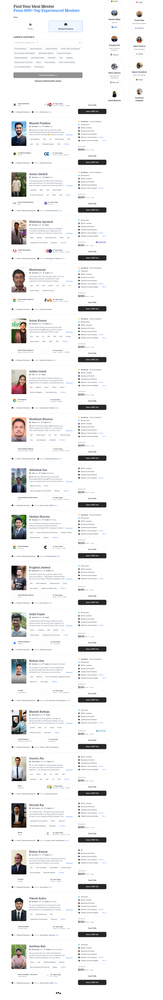
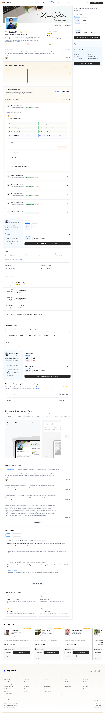
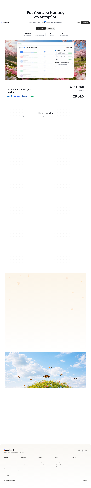
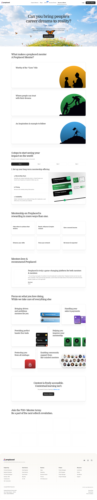

# Preplaced (`preplaced.in`) — Competitive UX, Trial-to-Subscription Funnel & Career Vertical Teardown

> **Threat Level to Familiarise**: **P0 — Direct Head-to-Head Competitor in Structured Long-Term 1:1 Tech Mentorship**  
> **Primary Surface Analyzed**: Public Landing Page (`/`), Mentor Discovery Directory (`/explore-mentors`), Star Mentor Profile + Trial Booking + Month-by-Month Curriculum (`/profile/manish-pushkar-60`), AI Job Search & Referral Autopilot (`/jobs-ai`), and Mentor Supply Onboarding (`/become-a-mentor`).

---

## 1. Executive Summary & Strategic Threat Assessment

Preplaced is Familiarise's most direct head-to-head Indian competitor in **high-ticket, multi-month 1:1 career mentorship** ("600+ mentors from Google, Amazon, Meta, Apple, PayPal, Microsoft"). While Topmate monetizes ad-hoc micro-transactions, Preplaced converts working software engineers, data scientists, and PMs into **1-month, 3-month, and 6-month Long-Term Mentorship (`LTM`) subscriptions ($149–$849/month + GST)** through three tightly integrated mechanisms:

1. **Universal Free 30-Min Trial Session Lead Magnet (`No Payment Required`)**: Every single CTA across home, mentor directory cards, and mentor profile headers anchors on `"Book a FREE Trial"` (`30 mins 1:1 call with the mentor`). Clicking `"View Pricing"` (`/checkout/ltm/<mentor-slug>`) deliberately gates subscription pricing behind an SMS OTP phone number wall so Preplaced's sales/mentor loop can follow up with high-intent leads.
2. **Concrete Month-by-Month Syllabus & Service-Level Guarantees**: Mentor profiles dynamically display expandable **1-Month, 3-Month, and 6-Month curriculums** breaking down every month into exact deliverables (_`1x Planning Session 30m` + `1x Upskilling Session 60m` + `1x Doubt Clearing Session 60m` + `1x Monthly Retrospective 30m` + `1x Mock Interview 30m` + `1x Evaluation Session 60m` + `Unlimited 24x7 Instant Call & Chat`_).
3. **Full-Funnel AI Job & Referral Companion (`Jobs AI` + `Leeco` Auto-Apply Extension)**: Launched prominently in the primary top navbar (`Jobs AI [New]`), Preplaced scans 500,000+ listings across LinkedIn, Naukri, Indeed, and Glassdoor, scores match percentages across Skills/Role/Experience/Location, auto-applies via browser extension, and surfaces warm LinkedIn employee referral contacts at target companies.

---

## 2. Funnel & Subscription Architecture Comparison: Preplaced vs. Familiarise

| Funnel Stage / Product Dimension         | Preplaced (`preplaced.in`)                                                                                                                                                                                                        | Familiarise (`familiarise_web`)                                                                                                                                           | Competitive Delta & Opportunity for Familiarise                                                                                                                                                                                                                            |
| :--------------------------------------- | :-------------------------------------------------------------------------------------------------------------------------------------------------------------------------------------------------------------------------------- | :------------------------------------------------------------------------------------------------------------------------------------------------------------------------ | :------------------------------------------------------------------------------------------------------------------------------------------------------------------------------------------------------------------------------------------------------------------------- |
| **Top-of-Funnel Conversion Hook**        | **Free 30-Min 1:1 Trial Call** (`No Payment Required`, instant Saturday/Sunday slot selection right on mentor profile)                                                                                                            | Direct paid booking of **1:1 Consultation** or **4–12 Week Subscription Plan** (plus free/paid Trial sessions where enabled)                                              | Familiarise already has `TrialSession` support in its data model — surfacing **"Book Free / Low-Cost Trial"** side-by-side with `"Subscribe"` directly on `/explore/experts` cards dramatically reduces buyer hesitation for ₹15k–₹50k multi-week plans.                   |
| **Subscription Packaging & Pricing**     | **1 / 3 / 6 Month LTM packages** priced monthly (`$149/mo` to `$849/mo + taxes`, with `Extra 10%–40% OFF` tags); checkout totals gated behind SMS OTP login (`/checkout/ltm/<slug>`)                                              | **Transparent Upfront Pricing** on **4–12 Week `SubscriptionPlan`s** (`callsPerWeek`, `sessionDurationInHours`, `emailSupport`) with zero login gate to view exact prices | Familiarise's transparent pricing builds immediate trust over Preplaced's SMS-wall checkout, especially when paired with itemized per-week session breakdowns.                                                                                                             |
| **Outcome Social Proof on Mentor Cards** | Explicit **Verified Placement Counter** (`45 Placements`, `21 Placements`, `17 Placements`), total mentoring minutes (`60,628+ Mins`), `Star Mentor - Top 30` badge, and multi-company alumni logos (`PayPal`, `Gartner`, `Dell`) | Domain, experience years, rating average, review count, and company badge                                                                                                 | Highlighting concrete mentee career transitions/outcomes and total mentorship hours/sessions completed increases conversion confidence on high-ticket subscriptions.                                                                                                       |
| **Ongoing Between-Session Value**        | **Jobs AI (`/jobs-ai`)**: Resume match scoring (`0–100`), application tracking, browser auto-apply extension, and 1-click company referral finder                                                                                 | Built-in **Stream Chat**, **Live Video Meeting Rooms**, **Shared Document Upload & Review (`/documents`)**, and **Recordings**                                            | Familiarise has superior in-platform execution workspaces (integrated Stream Chat + Stream Video + Document review repository). Positioning those assets visibly inside subscription plan cards directly counters Preplaced's _"Unlimited Chat + Task & Resources"_ pitch. |

---

## 3. Full Screenshot Index & Per-Screen UX Teardown

### 3.1 Landing Page & 3-Step Trial Funnel (`https://www.preplaced.in/`)

- **Hero Value Prop**: Contrasts 1:1 Long-Term Mentorship directly against cohort courses (_"Move Over traditional courses — 30% Cheaper compared to any 6 month course, 4x Results, 50% Faster"_).
- **Multi-Faceted Quick Filters**: Instant logo & pill navigation by **Target Company** (`Google`, `Amazon`, `Meta`, `Apple`, `PayPal`, `Adobe`, `Oracle`), **Target Role/Domain** (`Backend Developer 120+`, `Fullstack 86+`, `Data Scientist 48+`), and **Skill** (`System Design`, `DSA`, `React`, `Python`, `Java`).

### 3.2 Mentor Discovery Directory (`https://www.preplaced.in/explore-mentors`)

- **High-Density Horizontal Mentor Cards**: Each mentor card packs:
  1. Headshot + `Star Mentor - Top 30` ribbon + `17 Placements` outcome pill + `5.0 (20+ mentees)`
  2. Current role/employer (`Sr. Software Engineer @ PayPal`) + career pedigree strip (`Gartner`, `Dell`, `Mindtree`)
  3. Package inclusions (`4x Sessions Per Month`, `Unlimited Chat with Mentor`, `Referrals in Top Companies`, `Detailed Curriculum Available View ↗`)
  4. Price anchor (`Starting from $399 /Month + taxes`) + dual CTA (`View Profile` + primary black `Book a FREE Trial`).

### 3.3 Star Mentor Profile, Expandable Curriculum & Sticky Trial Picker (`https://www.preplaced.in/profile/manish-pushkar-60`)

- **Interactive Duration Tabs (`6 Months | 3 Months | 1 Month`)**: Dynamically calculates total sessions & topics (`36 Sessions • 170 Topics`) and expands each month into structured session quotas (`Planning`, `Upskilling`, `Doubt Clearing`, `Monthly Retrospective`, `Mock Interview`, `Evaluation`) plus 24x7 chat/call access.
- **Sticky Right-Rail Trial Booking Widget**: Pre-selects the earliest recommended weekend slot (`SAT 17 Oct -> 11:30 AM`) so the primary button reads dynamically: **`Book a FREE Trial Session for Oct 17, 11:30 AM`**.

### 3.4 AI Career & Referral Companion Vertical (`https://www.preplaced.in/jobs-ai`)

- **Full-Lifecycle Job Search Hook**: Tracks `5,00,007+ Jobs` across LinkedIn, Naukri, Indeed, and Glassdoor, displaying explainable 4-factor match cards (`SKILLS 85 | ROLE 72 | EXPERIENCE 68 | LOCATION 90`) and warm LinkedIn referral contacts per saved opening.

### 3.5 Mentor Supply Acquisition Landing Page (`https://www.preplaced.in/become-a-mentor`)

- **4-Step Creator Onboarding Pitch**: Emphasizes flexible weekend/evening hours, self-set monthly subscription pricing, and zero sales overhead (_"Focus on what you love doing, while we handle your sales, payments & scheduling tools"_).

---

## 4. Actionable Product & Frontend Takeaways for Familiarise

1. **Pre-Select Earliest Slot on Sticky Trial / Consultation Card (`Book Session for Sat, Oct 17 • 11:30 AM`)**: Instead of making users click through multiple steps to discover availability, pre-select the consultant's next open slot right in the sticky sidebar on `/explore/experts/[consultantDetailsId]`.
2. **Render Interactive Week-by-Week / Month-by-Month Curriculum Accordions on Subscription Plans**: Leverage `SubscriptionPlan`'s topic/curriculum structure to display an expandable syllabus breakdown (`Week 1..N`, session types, document reviews, chat support) that justifies multi-week pricing over ad-hoc calls.
3. **Surface Dual CTAs (`Book Trial` + `View Plans`) & Career Pedigree Badges on `/explore/experts` Cards**: Show past + current employer badges, total mentoring hours/sessions completed, and a secondary `Book Trial` button directly on expert directory cards.
