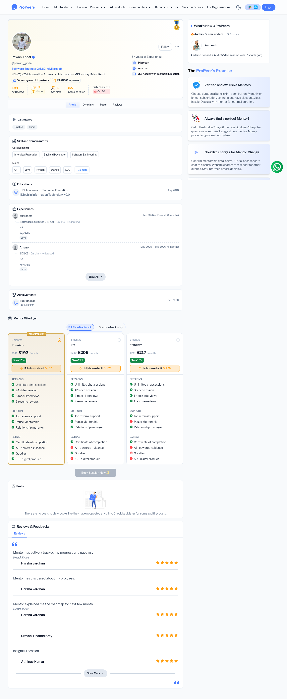
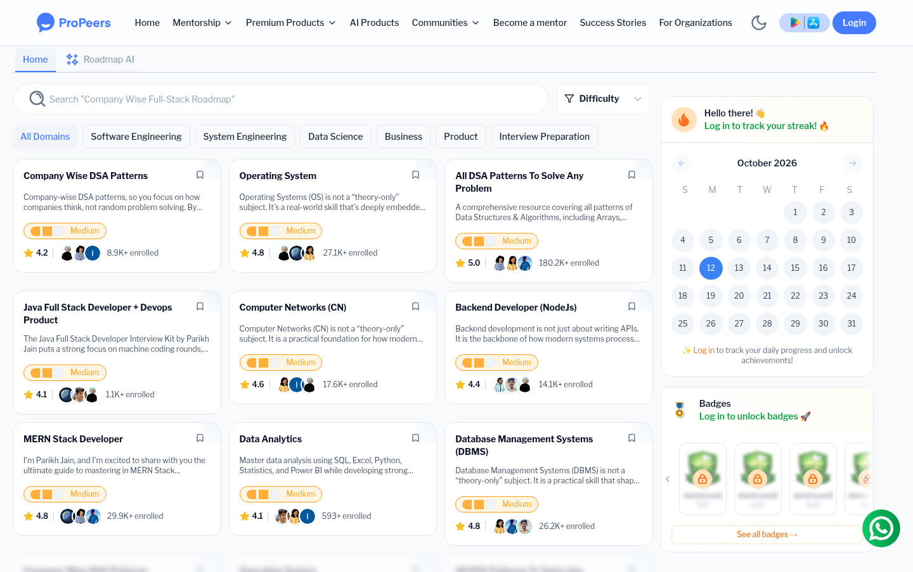
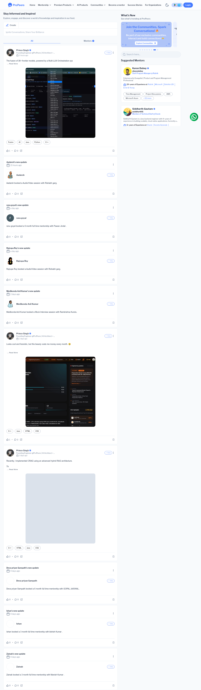

# ProPeers (`propeers.in`) — Competitive UX, Community Flywheel, Roadmaps & MAANG Mentorship Teardown

> **Threat Level to Familiarise**: **P1 — High-Growth Top-of-Funnel Community + Free Roadmap Flywheel Feeding Tiered Multi-Month Mentorship**  
> **Primary Surface Analyzed**: Landing Page (`/`), MAANG Mentors Directory (`/propeers`), Star Mentor Profile + Tiered 2/3/6-Month Plans + Risk Reversal (`/profile/pawan__jindal`), Structured Developer Roadmaps (`/roadmaps`), and Public Community Activity Feed (`/feed`).

---

## 1. Executive Summary & Strategic Threat Assessment

Founded by Parikh Jain (Ex-Amazon SDE & Founding Member at Coding Ninjas), ProPeers (`610k+ Users`, `300+ MAANG Mentors`, `4.9/5 Rating`) solves the **customer acquisition cost (CAC)** problem that plagues pure mentorship marketplaces. Instead of relying solely on cold paid ads or mentor self-promotion, ProPeers operates a **3-Stage Content -> Community -> Mentorship Flywheel**:

1. **Free High-Utility Self-Serve Roadmaps (`/roadmaps` — Top of Funnel)**: Structured, problem-by-problem study trackers (`All DSA Patterns To Solve Any Problem` with **180.2K+ enrolled**, `MERN Stack Developer` **29.9K+ enrolled**, `Operating Systems` **27.1K+ enrolled**) acquire hundreds of thousands of Indian CS undergraduates and early-career engineers organically at near-zero CAC.
2. **Real-Time Social Proof Community Feed (`/feed` — Middle of Funnel)**: Every live booking and mentorship purchase automatically emits a verified activity item into the public feed (_`"ranu goyal booked a 6 month full time mentorship with Pawan Jindal — 1 day ago"`_, _`"Deva priyan Sampath booked a 6 month full time mentorship with GOPAL JAISWAL — 4 days ago"`_), surrounded by right-rail `"Suggested Mentors"` cards.
3. **Scarcity-Driven Tiered Multi-Month Packages (`/profile/<handle>` — Bottom of Funnel)**: Individual profiles combine extreme scarcity tags (_`"fully booked till Oct 20"`_, _`"1 Slot left"`_), outcome badges (_`"Top 3% 🏆 Mentor"`_, _`"3 got hired"`_, _`"827+ Sessions taken"`_), transparent 3-tier subscription cards (**2-Month Standard / 3-Month Pro / 6-Month Premium** with 10%–20% bundle discounts and No Cost EMI), and aggressive buyer risk-reversal guarantees (**7-day unconditional full refund + free remaining-balance transfer to a new mentor**).

---

## 2. Product Architecture & Packaging Comparison: ProPeers vs. Familiarise

| Strategic Dimension                           | ProPeers (`propeers.in`)                                                                                                                                                                                                                                                         | Familiarise (`familiarise_web`)                                                                                             | Competitive Delta & Opportunity for Familiarise                                                                                                                                                                        |
| :-------------------------------------------- | :------------------------------------------------------------------------------------------------------------------------------------------------------------------------------------------------------------------------------------------------------------------------------- | :-------------------------------------------------------------------------------------------------------------------------- | :--------------------------------------------------------------------------------------------------------------------------------------------------------------------------------------------------------------------- |
| **Top-of-Funnel Lead Generation**             | Free interactive skill roadmaps (`180.2K+` enrolled on DSA patterns alone) + Digital Products (`500+ resources`)                                                                                                                                                                 | Direct expert discovery (`/explore/experts`) + public `ClassPlan` / `WebinarPlan` listings                                  | Familiarise's live/recorded **Webinars & Classes** can act as the exact same low-CAC acquisition wedge when cross-linked directly into the host consultant's 1:1 & Subscription plans.                                 |
| **Scarcity & Social Proof Mechanics**         | Dynamic scarcity pills (`1 Slot left`, `fully booked till Oct 20`), verified outcome counters (`3 got hired`, `827+ Sessions taken`), and public booking feed items (`/feed`)                                                                                                    | Verified consultant ratings, reviews, and live availability slots                                                           | Surfacing real scarcity indicators (_"Next slot: Oct 17"_, _"X consultations completed"_) on `/explore/experts` cards creates natural urgency without dark patterns.                                                   |
| **Subscription Tier Packaging**               | Explicit **Good / Better / Best** matrix right on profile (`2 Months Standard $217/mo [Save 10%]` vs `3 Months Pro $205/mo [Save 15%]` vs `6 Months Premium $193/mo [Most Popular, Save 20%]`) with itemized quotas (`24 video sessions + 6 mock interviews + 6 resume reviews`) | Multi-week `SubscriptionPlan` cards (`durationInMonths`, `callsPerWeek`, `sessionDurationInHours`, `emailSupport`, `price`) | Presenting 1-month / 3-month / 6-month plans side-by-side with explicit volume discount percentages (`Save 15%`, `Save 20%`) and `Most Popular` visual highlighting nudges buyers toward longer retention commitments. |
| **Buyer Risk Reversal (`ProPeer's Promise`)** | **7-day no-questions-asked refund** + **Zero-fee Mentor Switch** (unused subscription days credited automatically to a replacement mentor)                                                                                                                                       | Structured refund/cancellation pipeline (`Refund` table & ledger guarantees)                                                | Explicitly articulating Familiarise's payment protection, verified expert screening, and transparent cancellation/rescheduling guarantees right alongside checkout buttons directly eliminates high-ticket hesitation. |

---

## 3. Full Screenshot Index & Per-Screen UX Teardown

### 3.1 Landing Page & Ecosystem Hub (`https://www.propeers.in/`)

- **Ecosystem Positioning**: Positions ProPeers as an all-in-one career acceleration network (`610k+ Trusted by Users`, `10L+ Average Package`, `4.9/5 Mentor Rating`) spanning 6 core pillars: `Digital Products (500+)`, `Full Time Mentorship`, `Mentors (300+)`, `Roadmaps`, `Bootcamps`, and `Mock Interviews`.

### 3.2 MAANG Mentor Directory & Scarcity Cards (`https://www.propeers.in/propeers`)

- **High-Urgency Card Design**: Every mentor row highlights `Star Mentor`, `Top 3% 🏆 Mentor`, verified hiring outcomes (`3 got hired`), total sessions (`827+ Sessions taken`), real-time capacity status (`1 Slot left` / `fully booked till Oct 20`), career progression chain (`Microsoft <- Amazon <- MPL <- PayTM`), low entry anchor (`Starts @ $5 • No Cost EMI available`), and dual CTAs (`View Profile` + `Book 1:1 Session Now!`).

### 3.3 Star Mentor Profile, 3-Tier Pricing Matrix & Risk Reversal (`https://www.propeers.in/profile/pawan__jindal`)

- **Side-by-Side 2 / 3 / 6 Month Comparison Cards**: Clearly itemizes session counts (`24 vs 12 vs 8 video sessions`), `6 vs 3 vs 1 mock interviews`, `6 vs 3 vs 1 resume reviews`, `Unlimited chat sessions`, `Pause Mentorship`, and `Job referral support`.
- **`The ProPeer's Promise` Footer Strip**: Places four trust badges directly beneath the pricing cards: _Verified & Exclusive Mentors_, _7-Day Full Refund Guarantee_, _Free Mentor Change (Remaining Balance Credited)_, and _Pre-Booking Trial/Chat Clarity_.

### 3.4 High-Volume Structured Roadmaps (`https://www.propeers.in/roadmaps`)

- **Topic & Company-Specific Learning Paths**: Filterable by domain (`Software Engineering`, `System Engineering`, `Data Science`, `Product`, `Interview Preparation`) with social proof enrollment counts (`180.2K+ enrolled` on All DSA Patterns, `29.9K+` on MERN Stack, `27.1K+` on Operating Systems).

### 3.5 Community Discussion & Live Purchase Proof Feed (`https://www.propeers.in/feed`)

- **Hybrid Engineering Content + Purchase Ticker**: Interleaves technical posts from engineers/architects with live mentorship purchase announcements (_`"ranu goyal booked a 6 month full time mentorship with Pawan Jindal"`_) flanked by a sticky `"Suggested Mentors"` discovery rail.

---

## 4. Actionable Product & Frontend Takeaways for Familiarise

1. **Add Side-by-Side Tier Comparison (`Most Popular` Badge + Duration Savings) on Multi-Plan Profiles**: When a consultant offers multiple `SubscriptionPlan` tiers (e.g., 1-Month vs 3-Month vs 6-Month), render them in a visual comparison grid highlighting per-month savings (`Save 15%`) and concrete deliverables (calls, document reviews, chat support).
2. **Surface Real Session Volume & Availability Urgency on `/explore/experts`**: Display verified session counts (`100+ sessions completed`) and real upcoming availability indicators (_"Next slot tomorrow"_, _"2 slots left this week"_) derived directly from `SlotOfAvailabilityWeekly` / `SlotOfAvailabilityCustom`.
3. **Add a Concise Trust & Protection Banner Below Plan Selection Cards**: Highlight Familiarise's verified consultants, secure escrow/payment handling, seamless session rescheduling, and dedicated support directly next to the booking CTA.
