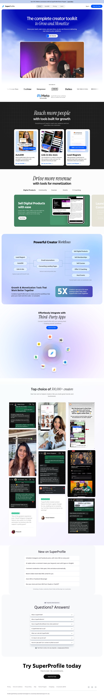
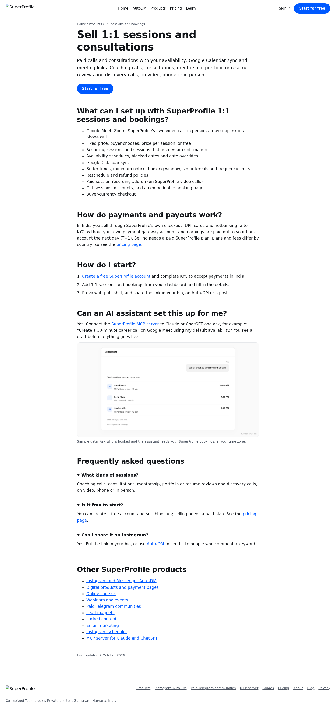
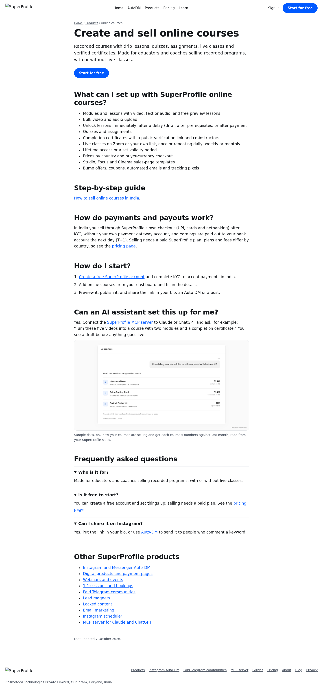

# SuperProfile (`superprofile.bio`) — Competitive Creator Commerce, 1:1 Bookings & Flat-Fee SaaS Teardown

> **Threat Level to Familiarise**: **P1 High-Volume Creator Storefront & 0%-Commission SaaS Alternative**  
> **Primary Surfaces Analyzed**: Main Creator Toolkit Landing Page (`/`), Dedicated 1:1 Sessions & Consultations Product Page (`/products/bookings`), Online Courses & Live Classes Product Page (`/products/courses`), and Creator SaaS Pricing & Feature Matrix (`/pricing`).

---

## 1. Executive Summary & Strategic Threat Assessment

SuperProfile (`superprofile.bio`, formerly Cosmofeed / SuperProfile India, `500,000+` Indian & global creators) attacks the exact creator commerce intersection as Topmate and Familiarise—combining **top-of-funnel Instagram/Facebook DM automation (`AutoDM`)** with **full-stack knowledge commerce (`1:1 Bookings`, `Online Courses`, `Live Webinars/Events`, `Digital Products`, `Paid Telegram/Discord Communities`)**:

1. **Flat-Fee SaaS (`$29/mo` after `$4.99` intro month) + `0% Commission Fee Charged`**: Where Topmate (`10%–20%` per transaction) and Familiarise (`20%` platform fee) take a percentage of every sale, SuperProfile charges **zero platform commission** on GMV—making it mathematically irresistible once an educator/consultant exceeds ₹15,000–₹20,000/month in gross bookings.
2. **Zero-Gateway-Setup UPI Checkout + Next-Day (`T+1`) Bank Payouts**: Creators complete lightweight KYC once inside SuperProfile and immediately accept Indian **UPI, cards, and netbanking** plus international buyer-currency checkout without registering a standalone Razorpay/Stripe merchant account, receiving **T+1 settlements**.
3. **High-Margin Add-On Upsells & Order Bumps Built Into Checkout**:
   - **1:1 Bookings (`/products/bookings`)**: Native support for a **Paid Session-Recording Add-On** on built-in video calls, gift sessions, frequency limits, buffer times, and approval-gated bookings.
   - **Courses & Live Cohorts (`/products/courses`)**: Combines drip video/audio lessons, quizzes, assignments, public-URL verified certificates, co-instructors, and recurring Zoom live classes with **checkout order bump offers**.
4. **AI-Native Storefront Provisioning (`superprofile.bio/mcp`)**: Ships a first-party MCP server enabling creators to launch 1:1 consultation SKUs, courses, and AutoDM campaigns directly from Claude, ChatGPT, Gemini, or Cursor.

---

## 2. Business Model & Feature Matrix vs. Familiarise

| Dimension                                 | SuperProfile (`superprofile.bio`)                                                                                                                   | Familiarise (`familiarise_web`)                                                                    | Strategic Implication for Familiarise                                                                                                                                                    |
| :---------------------------------------- | :-------------------------------------------------------------------------------------------------------------------------------------------------- | :------------------------------------------------------------------------------------------------- | :--------------------------------------------------------------------------------------------------------------------------------------------------------------------------------------- |
| **Platform Monetization Model**           | **Pure SaaS (`Starter Free` / `Creator $4.99 first mo -> $29/mo` / `Pro Custom`)** + **0% transaction commission**                                  | **0/mo upfront fee** + **20% commission per transaction** (80/20 payout split)                     | Zero upfront monthly fee lowers day-1 signup friction on Familiarise, but high-earning creators (`₹50k+/mo`) face strong economic incentives to evaluate optional SaaS/capped-fee tiers. |
| **1:1 Booking Monetization Upsells**      | **Paid Session-Recording Add-On** on native video calls + Gift Sessions + Buyer-chooses price                                                       | Fixed plan price (`ConsultationPlan`), recording governed by host/plan settings                    | Offering an optional **Paid Session Recording & AI Transcript Add-On** (`+₹199` / `+₹299`) at 1:1 checkout increases average order value (AOV) with near-100% gross margin.              |
| **Course + Live Cohort Hybrid**           | Recorded drip modules + quizzes + assignments + **publicly verifiable completion certificates** + recurring live classes + **checkout bump offers** | Live scheduled cohorts (`ClassPlan`) + standalone `WebinarPlan` + document sharing                 | Adding **verifiable shareable completion certificates** (`familiarise.in/verify/<id>`) for `ClassPlan` / `SubscriptionPlan` graduates creates organic LinkedIn viral loops.              |
| **Creator Payout Cadence**                | **T+1 next-day automated bank settlement** after instant in-app KYC                                                                                 | Scheduled payout batching + hold window for dispute safety                                         | Highlighting predictable payout timelines and transparent ledger statements in the Consultant Dashboard reinforces trust.                                                                |
| **Discovery vs. Bring-Your-Own-Audience** | **Pure BYOA (`AutoDM` + Link-in-Bio)** — zero public marketplace directory                                                                          | **Hybrid Marketplace (`/explore/experts`, `/explore/programs`) + Direct Consultant Profile Links** | Familiarise's **organic marketplace discovery** is its primary moat over pure SaaS tools like SuperProfile that leave creators 100% responsible for their own traffic.                   |

---

## 3. Full Screenshot Index & Per-Screen UX Teardown

### 3.1 Creator Toolkit Landing Page & Interactive Product Switcher (`https://superprofile.bio/`)

- **Full-Funnel "Grow -> Capture -> Monetize" Narrative**: Top section anchors on Meta-certified `AutoDM`, `Link-in-bio store`, and `Lead Magnets`, flowing into an interactive 5-tab monetization switcher (`Digital Products | Community | Courses | Events | 1:1 Coaching`) backed by `500,000+ creators` social proof and a `50% lifetime affiliate partner banner`.

### 3.2 Dedicated 1:1 Bookings & Consultations Product Page (`https://superprofile.bio/products/bookings`)

- **Comprehensive 1:1 Configuration Spec**: Highlights flexible pricing modes (`Fixed price`, `Buyer-chooses / pay-what-you-want`, `Price per session`, `Free`), approval-gated sessions, Google Calendar sync, buffer times, reschedule/refund policy controls, **Paid Session-Recording Add-On**, and **T+1 UPI/Card settlement**.

### 3.3 Dedicated Courses, Cohorts & Live Webinars Product Page (`https://superprofile.bio/products/courses`)

- **Structured Cohort & LMS Depth**: Merchandises video/text/audio modules, free preview lessons, drip schedules, prerequisite gates, quizzes/assignments, **verified completion certificates with public URLs**, co-instructors, 3 high-converting landing page templates (`Studio`, `Focus`, `Cinema`), and checkout order bump offers.

### 3.4 Creator Pricing Plans & Consolidation Calculator (`https://superprofile.bio/pricing`)

- ** Tool-Stack Replacement Anchor (`$217/mo` -> `$29/mo` + `0% Commission`)**: Visually itemizes 6 standalone subscriptions (`AutoDMs $15 + Link-in-Bio $29 + Calendar $15 + Course Builder $119 + Email Marketing $29 + Analytics $10 = $217/mo`) directly against SuperProfile Creator (`$4.99 first month, then $29/mo, 0% Commission Fee Charged`).

---

## 4. Actionable Product & UX Takeaways for Familiarise

1. **Verifiable Completion Certificates (`ClassPlan` & Multi-Week `SubscriptionPlan`)**: Auto-issue a clean shareable certificate URL when a consultee completes all sessions in a `Class` or multi-week `Subscription`, driving organic LinkedIn feed impressions back to the consultant's Familiarise profile.
2. **Optional Checkout Add-On ("Session Recording & Summary Pack")**: Mirror SuperProfile's paid recording toggle on 1:1 consultations where permitted, letting consultees opt into persistent cloud recording access directly on the checkout screen.
3. **Optional "Creator Pro" SaaS Tier for High-Volume Consultants**: For established educators bringing their own Instagram/LinkedIn traffic who balk at a 20% take rate on ₹5,000+ cohorts, evaluate an optional monthly SaaS subscription tier that reduces platform commission on direct-link bookings to `0%–5%` while keeping `20%` on Familiarise Marketplace-attributed discovery bookings.
