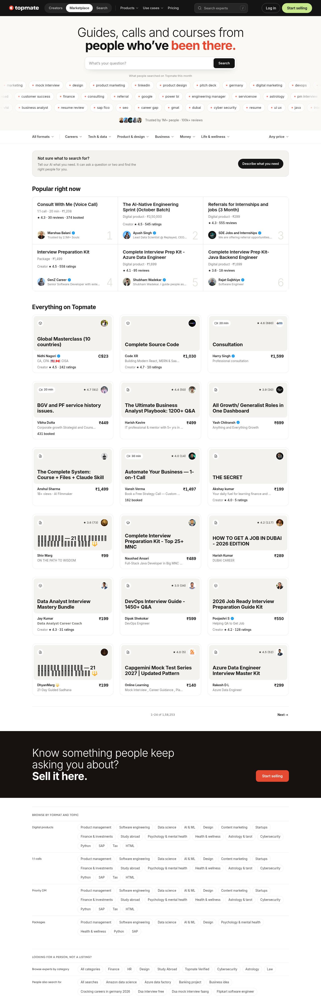
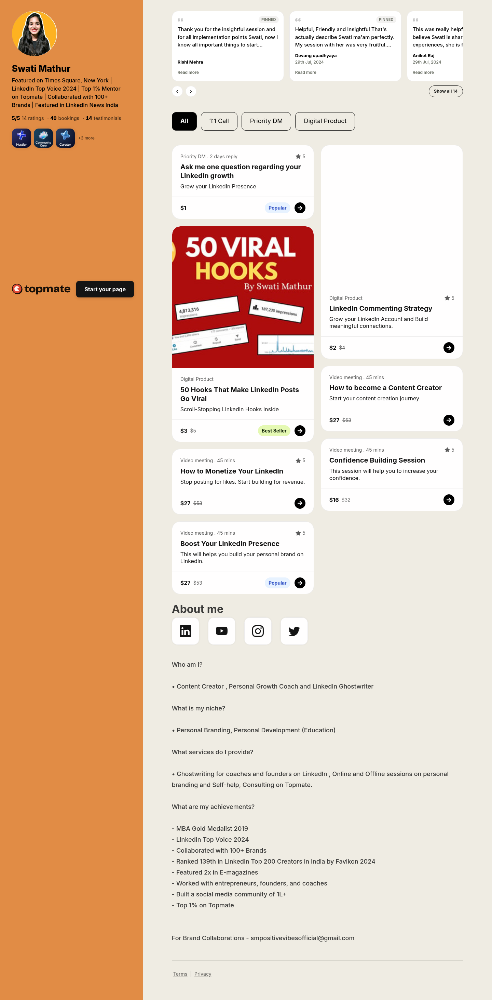
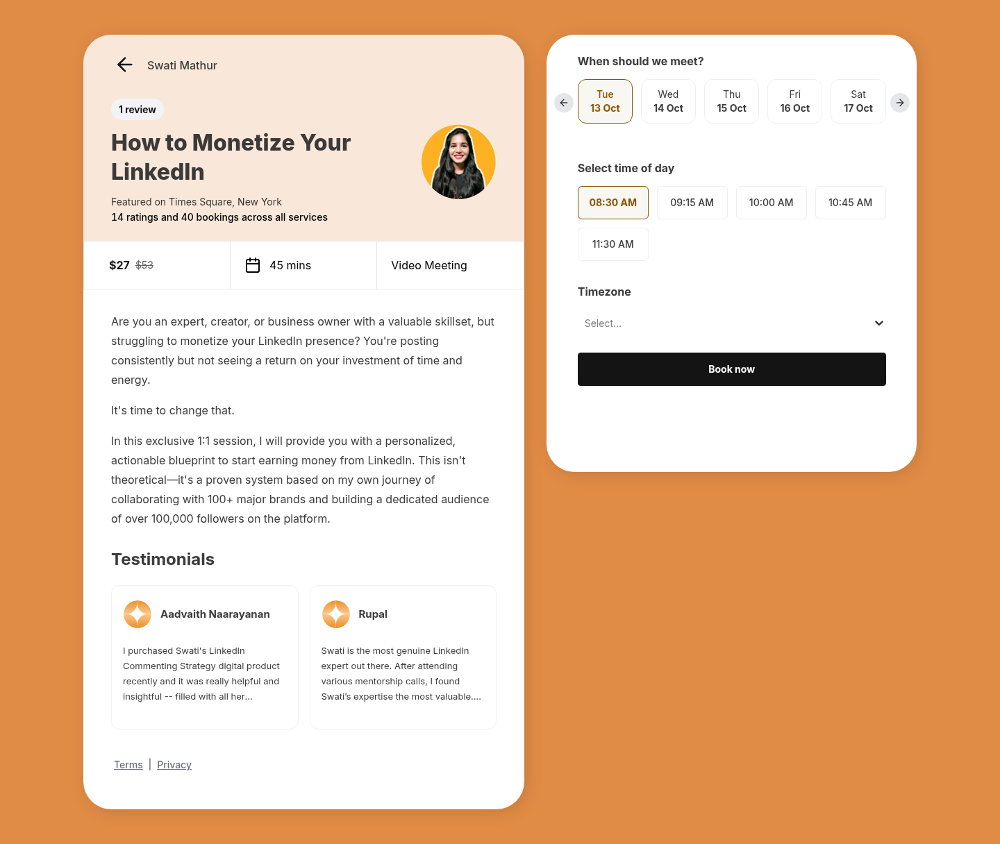
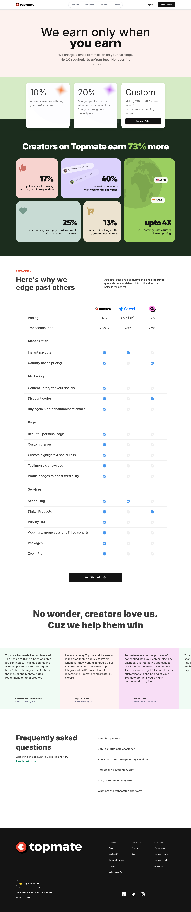
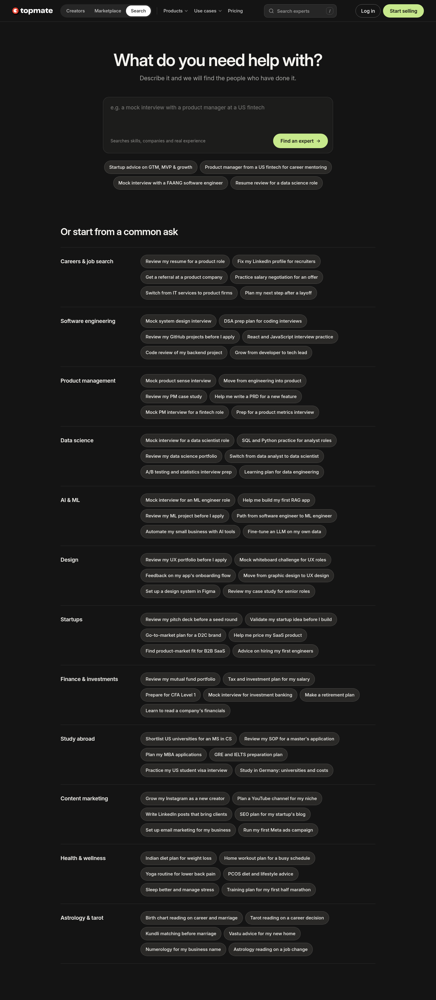

# Topmate (`topmate.io`) — Competitive UX, Storefront & Business Model Teardown

> **Threat Level to Familiarise**: **P0 — Existential Creator Storefront, Low-Friction Checkout & Intent-Search Threat**  
> **Primary Surface Analyzed**: Public landing page, Marketplace directory, AI Intent Search (`/search`), Top-1% Creator Storefront (`/swati_mathur`), Direct Service Checkout (`/<username>/<serviceId>`), and Creator Commission/Pricing (`/pricing`).

---

## 1. Executive Summary & Strategic Threat Assessment

Topmate dominates India's link-in-bio creator monetization and 1:1 career/creator consultation market ("Topmate has paid ₹100+ crore to creators"). Rather than positioning itself solely as a heavyweight long-term mentorship marketplace, Topmate combines **three self-reinforcing growth loops**:

1. **Zero-Friction Link-in-Bio Creator Storefront (`topmate.io/<username>`)**: Creators share their link directly across LinkedIn, Instagram, and X. Every profile header embeds a `"Start your page"` CTA button that turns consultees into supply-side creators.
2. **Micro-Ticket to High-Ticket Value Ladder ($1 -> $3 -> $27 -> Cohorts/Packages)**: Creators stack low-commitment entry offers (**$1 Priority DM** with 48h reply guarantee, **$2–$5 Digital Products** with strikethrough anchor pricing) directly above **45-min 1:1 Video Consultations ($27 strikethrough $53)** and **Multi-Week Live Cohorts / Packages**.
3. **Dual-Engine Discovery (`Marketplace` + Natural-Language Intent `/search`)**: Alongside keyword pills (`devops`, `data engineer`, `mock interview`, `pm interview`, `system design`), Topmate's `/search` surface invites buyers to describe their problem in plain English (_"Product manager from a US fintech for career mentoring"_, _"Switch from IT services to product firms"_), matching intent directly to expert offerings.

---

## 2. Business Model & Take Rate Analysis vs. Familiarise

| Dimension                                  | Topmate (`topmate.io`)                                                                                                                                                                                                   | Familiarise (`familiarise_web`)                                                           | Strategic Implication for Familiarise                                                                                                                                                                                          |
| :----------------------------------------- | :----------------------------------------------------------------------------------------------------------------------------------------------------------------------------------------------------------------------- | :---------------------------------------------------------------------------------------- | :----------------------------------------------------------------------------------------------------------------------------------------------------------------------------------------------------------------------------- |
| **Direct Link / Creator-Driven Take Rate** | **10%** commission on sales made through the creator's direct link (`topmate.io/<username>`) + **2%–3%** payment processing fee                                                                                          | **Flat 20% platform fee** (80/20 consultant split across all bookings)                    | Topmate rewards creators who bring their own LinkedIn/Instagram traffic with half the commission (10% vs 20%), making Topmate the default link-in-bio utility for Indian tech & creator voices.                                |
| **Marketplace-Driven Take Rate**           | **20%** transaction fee when _new_ buyers discover and purchase via Topmate Marketplace / Search                                                                                                                         | **Flat 20% platform fee** (80/20 split)                                                   | Familiarise's 20% rate matches Topmate's _marketplace_ take rate, meaning Familiarise must justify its 20% fee through organic discovery demand, structured curriculum value, or reduced commission for self-sourced bookings. |
| **High-Earner Tier**                       | **Custom Enterprise Rate** for creators earning **₹10L+ / $20k+ per month**                                                                                                                                              | Standard flat rate                                                                        | Top creators face strong incentives to negotiate lower take rates once volume scales.                                                                                                                                          |
| **Monetization Surface Breadth**           | 8 modular product types: **1:1 Meetings**, **Priority DM**, **Digital Products**, **Packages/Bundles**, **Webinars**, **Cohorts**, **Courses**, **Memberships** + **Instagram Auto-DM / Loop / Cart Abandonment Emails** | **1:1 Consultations**, **Multi-Week Mentorship Subscriptions**, **Webinars**, **Classes** | Familiarise excels at structured multi-week mentorship & live classes with built-in video/chat rooms, whereas Topmate wins impulse single-item checkout (Priority DMs, PDF kits, anchor-priced 1:1s).                          |

---

## 3. Full Screenshot Index & Per-Screen UX Teardown

### 3.1 Landing Page & Creator Value Proposition (`https://topmate.io/`)

- **Hero Positioning**: Bold editorial typography (_"SELL WHAT YOUR PEOPLE ASK FOR"_) paired with immediate social proof (_"Topmate has paid ₹100+ crore to creators"_) and split primary CTAs (`Start selling` for supply vs `Book an expert` for demand).
- **Modular Offer Showcase**: Interactive tabs let prospective creators preview all 8 monetization formats (`Meetings`, `Webinars`, `Cohorts`, `Courses`, `Digital Products`, `Packages`, `Priority DM`, `Memberships`) above automated operations (`Zoom Pro`, `Calendar sync`, `Reminders`, `Testimonials`, `Instagram Auto DM`, `Loop`).

### 3.2 Marketplace Directory & Popular Offerings (`https://topmate.io/marketplace`)

- **SKU-First Merchandising**: Unlike directories that only list mentor headshots, Topmate's marketplace merchandises **concrete deliverable cards** (_"Complete Interview Prep Kit - Azure Data Engineer"_, _"Referrals for Internships and jobs (3 Month)"_, _"Consult With Me (Voice Call)"_).
- **High-Intent Topic Pills**: Rapid horizontal pill filters (`devops`, `data engineer`, `mock interview`, `pm interview`, `system design`, `google`, `referral`) map directly to high-intent job-switching queries.

### 3.3 Live Creator Storefront (`https://topmate.io/swati_mathur`)

- **Trust Density Above the Fold**: Immediate credibility stack (`5/5`, `14 ratings`, `40 bookings`, `14 testimonials`, `Top 1% Mentor on Topmate`) paired with a horizontal **Pinned Testimonials** carousel _before_ the user even scrolls to pricing.
- **Segmented Service Tabs & Strikethrough Anchor Pricing**: Filter pills (`All | 1:1 Call | Priority DM | Digital Product`) organize 14 SKUs cleanly. Every paid service displays an explicit strikethrough anchor price (`$27` ~~`$53`~~ for 45-min video call, `$3` ~~`$5`~~ Best Seller digital hook guide, `$1` Priority DM lead magnet).

### 3.4 Direct 1:1 Consultation Checkout & Slot Picker (`https://topmate.io/swati_mathur/1696266`)

- **Zero-Auth-Wall Split Checkout**: Left column reinforces session outcomes + verified buyer reviews; right sticky card immediately renders **inline date pills** (`Tue 13 Oct` – `Mon 19 Oct`), **one-tap time slots** (`08:30 AM`, `09:15 AM`, `10:00 AM`...), auto-detected timezone selector, and a prominent `Book now` CTA **without forcing sign-up before seeing live slot availability**.

### 3.5 Creator Pricing & Commission Breakdown (`https://topmate.io/pricing`)

- **Transparent "We Earn Only When You Earn" Framing**: Zero monthly subscription (`$0/mo`), clearly contrasting **10% direct profile link commission** vs **20% marketplace acquisition fee**, plus side-by-side feature matrix comparing built-in scheduling, country-based PPP pricing, cart abandonment emails, and instant bank payouts.

### 3.6 Natural-Language AI Intent Search (`https://topmate.io/search`)

- **Problem-First Discovery Taxonomy**: Categorizes hundreds of real mentee prompts across `Careers & job search`, `Software engineering`, `Product management`, `Data science`, `AI & ML`, `Design`, `Startups`, and `Study abroad` so hesitant users click an exact problem statement (_"Mock system design interview"_, _"Switch from IT services to product firms"_).

---

## 4. Actionable Product & Frontend Takeaways for Familiarise

1. **Expose Live Slot Availability on Public Consultant Profiles Without Pre-Login Gate**: Replicate Topmate's zero-wall slot preview (`When should we meet?` date pills + immediate available time pills) right on `/explore/experts/[consultantDetailsId]`, requiring auth only at payment/confirmation step.
2. **Support Strikethrough Anchor Pricing & "Best Seller / Popular" Badges on Plans**: Allow consultants to configure optional compare-at prices and surface automatic booking-count / rating badges (`Top Rated`, `Popular`, verified session count) on `ConsultationPlan`, `SubscriptionPlan`, and `WebinarPlan` cards.
3. **Add Problem-Statement Quick Chips on `/explore/experts`**: Complement domain/subdomain dropdowns with high-intent prompt chips (_"System Design Mock Interview"_, _"Switch to Product Management"_, _"Resume & LinkedIn Review"_) mapped directly to existing tags/topics.
4. **Evaluate Referral / Self-Sourced Attribution Fee Tier**: Consider rewarding consultants who drive bookings via their direct `/explore/experts/<id>?ref=creator` link with a reduced platform commission rate (or bonus visibility boost in marketplace search) while preserving the standard 80/20 split on platform-sourced demand.
