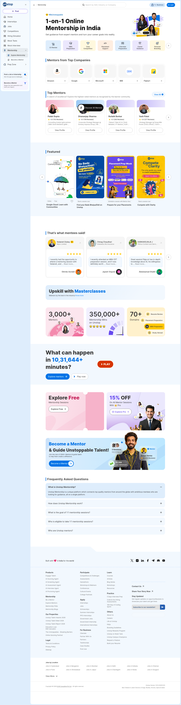
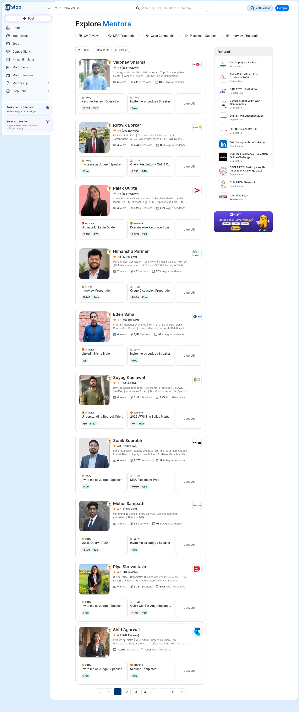
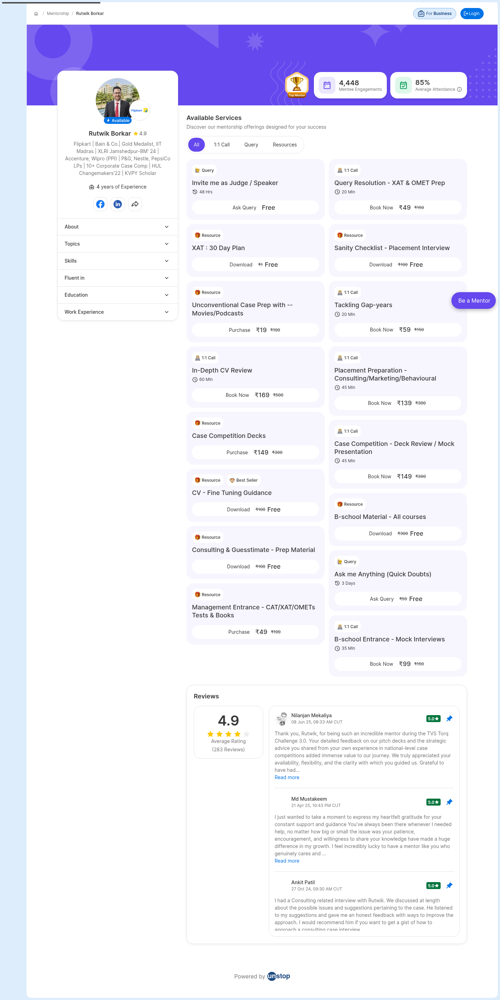
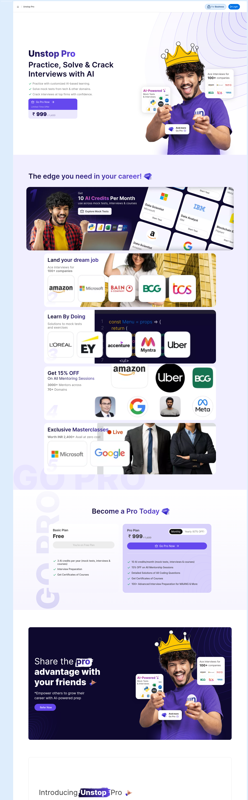
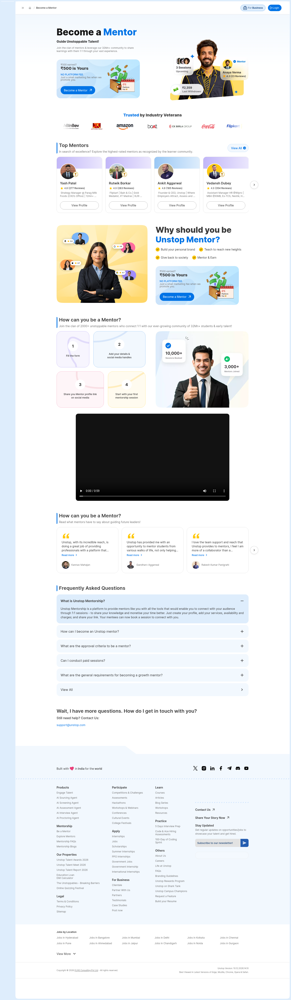

# Unstop Mentorship (`unstop.com/mentorship`) — Competitive UX, Top-of-Funnel Distribution & Subscription Teardown

> **Threat Level to Familiarise**: **P0 Campus & Early-Career Funnel Threat (32M+ Student/Early-Pro Distribution + Zero-Fee Mentor Acquisition)**  
> **Primary Surfaces Analyzed**: Mentorship Landing Hub (`/mentorship` -> `/mentor`), Mentor Discovery Directory (`/find-a-mentor`), Public Mentor Storefront (`/mentor/rutwik`), Unstop Pro Pass Subscription (`/pro`), and Supply Onboarding (`/become-a-mentor`).

---

## 1. Executive Summary & Strategic Threat Assessment

Unstop (formerly Dare2Compete) commands **India's largest top-of-funnel student and early-career community (32M+ registered learners across engineering & MBA campuses)** through hackathons, case competitions, and entry-level job listings. Unstop monetizes that captive audience via two tightly interlocked mentorship flywheels:

1. **Zero-Take-Rate Supply Acquisition (_"₹500 earned? ₹500 is Yours — NO PLATFORM FEE"_)**: Unlike pure mentorship platforms that depend on 10%–20% take rates to survive, Unstop subsidizes 1:1 mentor payouts (charging **0% base platform commission** on self-driven links, charging only an optional marketing fee when Unstop boosts the mentor) because Unstop's primary margin comes from **B2B corporate hiring challenges** (`For Business`) and **Unstop Pro consumer subscriptions**.
2. **Hyper-Accessible Campus Micro-Pricing (`Free` / `₹19` / `₹49` / `₹99` / `₹169`)**: Mentors are predominantly recent IIM/XLRI/IIT competition winners and young SDEs/PMs selling bite-sized tactical SKUs (`Resume Review ₹49`, `XAT Query Resolution 20 Min ₹49`, `In-Depth CV Review 60 Min ₹169` ~~`₹500`~~).
3. **Unstop Pro Cross-Subsidy Pass (`₹999` / yr)**: Bundles **15% OFF all 1:1 mentorship bookings** across `3,000+ mentors` with **10 AI credits/month** (mock tests & AI interviews), **free masterclasses worth ₹2,400+**, and company-specific prep kits.

---

## 2. Business Model & Positioning Comparison vs. Familiarise

| Dimension                              | Unstop Mentorship (`unstop.com`)                                                                                                     | Familiarise (`familiarise_web`)                                                                                                                                                                              | Strategic Implication for Familiarise                                                                                                                                                                                                   |
| :------------------------------------- | :----------------------------------------------------------------------------------------------------------------------------------- | :----------------------------------------------------------------------------------------------------------------------------------------------------------------------------------------------------------- | :-------------------------------------------------------------------------------------------------------------------------------------------------------------------------------------------------------------------------------------- |
| **Target Buyer Persona & Ticket Size** | College students & 0–2 yr grads buying **₹29–₹169 tactical micro-sessions** (case comp prep, CAT/XAT, resume quick check)            | Ambitious early-to-mid career professionals & serious upskillers buying **structured 1:1 consultations, multi-week mentorship subscriptions (`SubscriptionPlan`), cohorts (`ClassPlan`), and live webinars** | **Do not race Unstop to ₹49 student resume checks.** Position Familiarise decisively upmarket around **verified mid/senior industry practitioners, multi-week outcome roadmaps, and structured cohorts**.                               |
| **Creator / Mentor Commission**        | **0% base fee** (_"₹500 earned? ₹500 is Yours"_); fee only on marketplace promotion                                                  | **20% platform commission** (80/20 consultant payout split)                                                                                                                                                  | Highlight Familiarise's **built-in enterprise workflow value** (native video rooms, Stream persistent channels, multi-session scheduling, automated invoicing/payouts, and structured curriculum hosting) vs Unstop's raw booking link. |
| **Subscription Membership Loop**       | **Unstop Pro (`₹999` ~~`₹1,499`~~)**: `15% OFF all mentor sessions` + AI practice credits + free masterclasses                       | Per-plan `SubscriptionPlan` (consultant-specific recurring mentorship)                                                                                                                                       | Consider an optional platform-wide **Familiarise Pass / Member Discount** or bundle credit for live `WebinarPlan` + `ConsultationPlan` discounts.                                                                                       |
| **Attendance & Reliability Proof**     | Explicitly badges **`4,448 Mentee Engagements`** + **`85% Average Attendance`** + **`Available`** right on the mentor profile header | Rating & bio                                                                                                                                                                                                 | Surfacing **verified attendance / response reliability (`98% Session Completion`)** builds strong buyer confidence for higher-ticket bookings.                                                                                          |

---

## 3. Full Screenshot Index & Per-Screen UX Teardown

### 3.1 Mentorship Hub Landing Page (`https://unstop.com/mentorship`)

- **Outcome-First Quick Filter Chips**: Immediately below _"1-on-1 Online Mentorship in India"_, clickable problem pills (`CV Review`, `MBA Preparation`, `Case Competition`, `Placement Support`, `Interview Preparation`, `Career Guidance`, `Personal Branding`, `Study Abroad`, `Coding & Software`) route straight into pre-filtered `/find-a-mentor?skills=...` views.
- **Volume Proof & Free Trial Funnel**: Showcases _"What can happen in 10,31,644+ minutes?"_ alongside dedicated cards for **`Explore Free Mentorship Sessions`** (`?price=0:0`) and **`15% OFF On All Mentor Sessions With 👑 Pro`**.

### 3.2 Active Mentor Discovery Directory (`https://unstop.com/find-a-mentor`)

- **Inline Bookable Service Rows Inside Directory Cards**: Each mentor card displays two bookable SKU rows right inside the search grid (e.g., `1:1 Call: Query Resolution - XAT & OMET Prep ₹49` ~~`₹150`~~, `Query: Resume Review ₹49` ~~`₹199`~~) so buyers can jump directly to checkout (`/mentor/book-mentor/<serviceId>/<mentorId>`) in **one click** without even loading the mentor's full profile.

### 3.3 Public Mentor Storefront & Micro-SKU Matrix (`https://unstop.com/mentor/rutwik`)

- **Granular Credibility Badges**: Header displays `4,448 Mentee Engagements`, `85% Average Attendance`, green `Available` badge, `4.9 ★`, and collapsible credential accordions (`About`, `Topics`, `Skills`, `Fluent in`, `Education`, `Work Experience`).
- **4-Type SKU Taxonomy (`All | 1:1 Call | Query | Resources | Be a Mentor`)**: Mixes free lead magnets (`Sanity Checklist Free`, `Invite me as Judge Free`), low-friction PDFs (`₹19`–`₹149`), and duration-tiered 1:1 calls (`20 Min ₹49`, `45 Min ₹139`, `60 Min ₹169` ~~`₹500`~~).

### 3.4 Unstop Pro Subscription Bundle (`https://unstop.com/pro`)

- **Cross-Product Value Stacking**: Compares `Basic Plan (Free — 3 AI credits/yr)` vs `Pro Plan (₹999` ~~`₹1,499`~~ `— 10 AI credits/mo, 15% OFF all mentorship sessions across 3,000+ mentors, free masterclasses worth ₹2,400+, 100+ MAANG prep packs)`.

### 3.5 Supply-Side Mentor Acquisition Page (`https://unstop.com/become-a-mentor`)

- **Zero-Commission Headline Hook**: Leads boldly with _"Join the clan of mentors & leverage our 32Mn+ community"_ and _"₹500 earned? ₹500 is Yours — NO PLATFORM FEE. Just a small marketing fee when we promote you."_ alongside social proof from high-review competition winners (`150–354 reviews`).

---

## 4. Concrete Product & UX Takeaways for Familiarise

1. **Surface Top 1–2 Bookable Plans Directly Inside `/explore/experts` Directory Cards**: Like Unstop's inline SKU rows (`1:1 Call • 45 Min • ₹X`), show each consultant's flagship `ConsultationPlan` and `SubscriptionPlan` price + duration pill directly on the search card with a direct `Book` action.
2. **Add "Free Webinars / Intro Sessions" Filter Pill on `/explore/experts` & `/explore/programs`**: Mirror Unstop's `Explore Free Sessions` conversion funnel by letting hesitant first-time consultees filter for upcoming free/low-ticket community webinars and intro consultations.
3. **Display Session Completion / Reliability Badges on Consultant Profiles**: Surface verified platform reliability metrics (`100% On-Time`, `Verified Industry Practitioner`, completed session count) to differentiate Familiarise's senior experts from Unstop's student/peer mentors.
